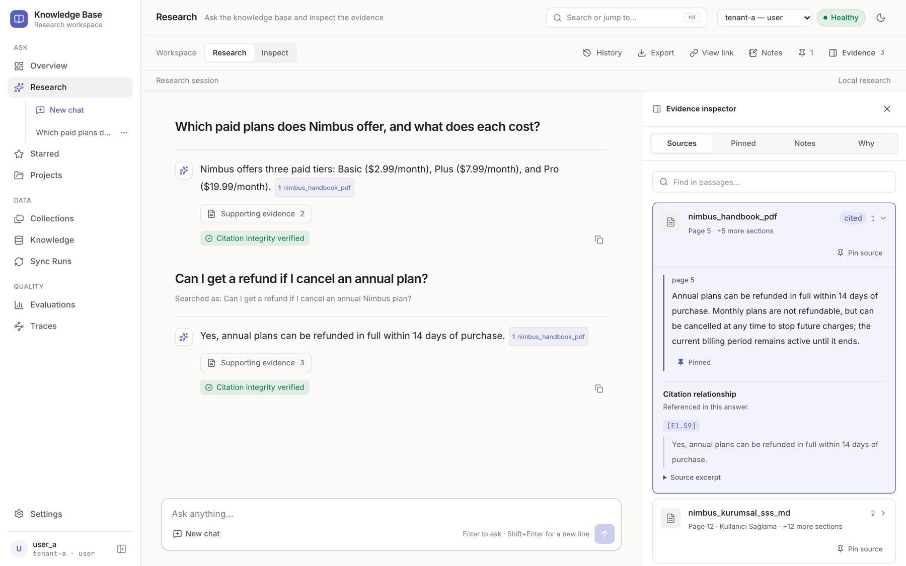
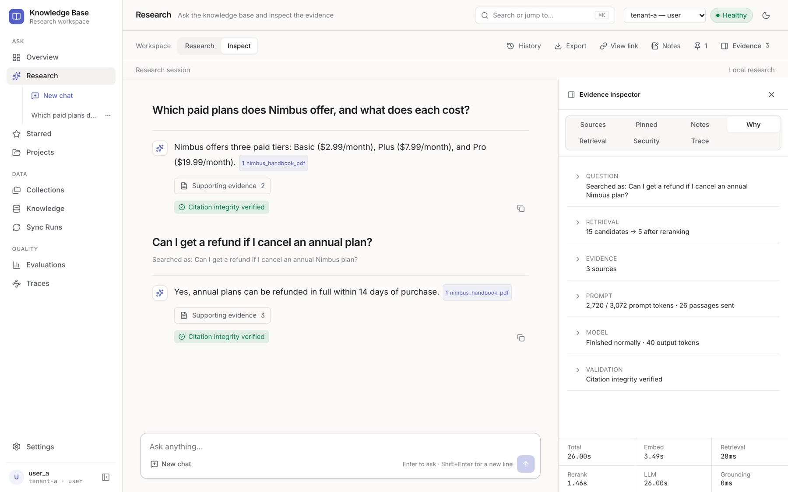
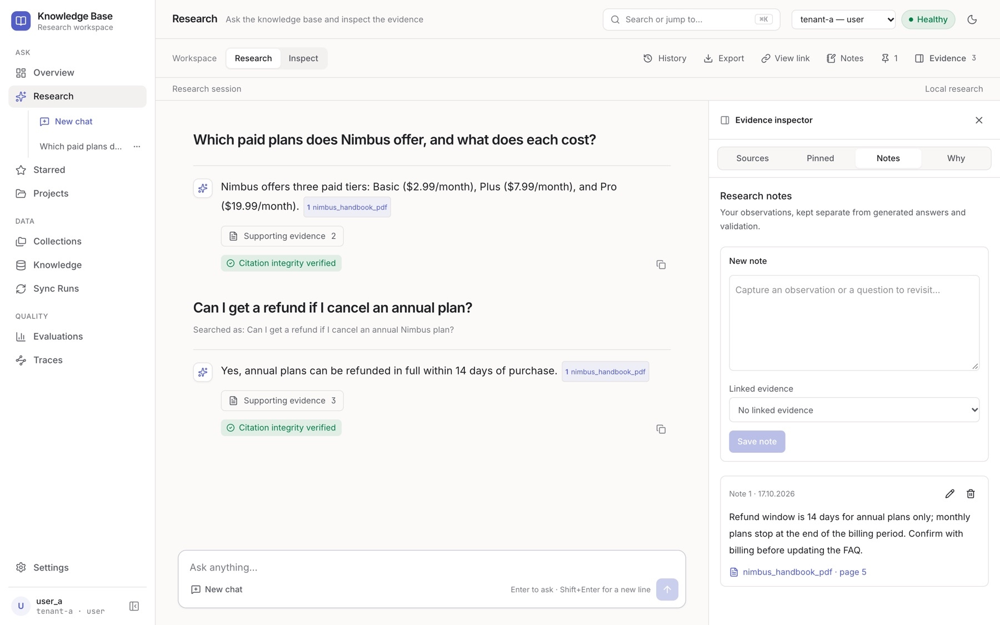
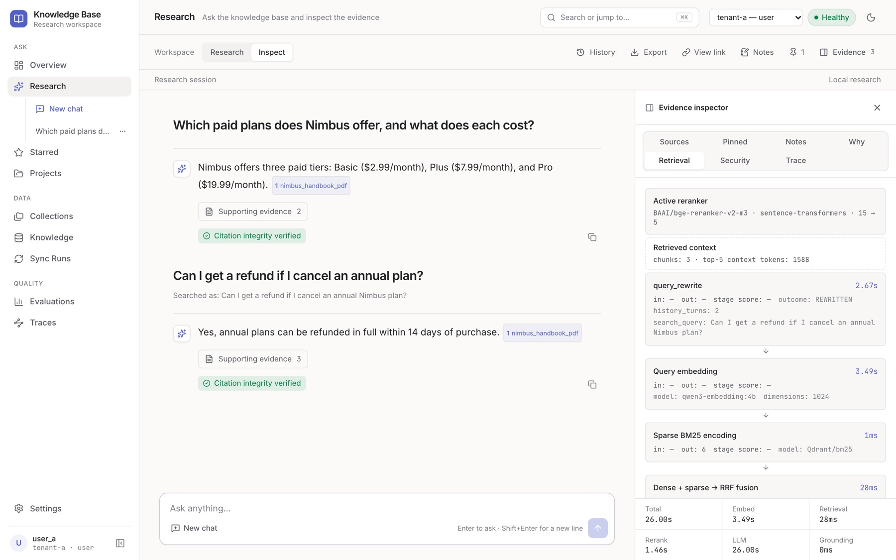
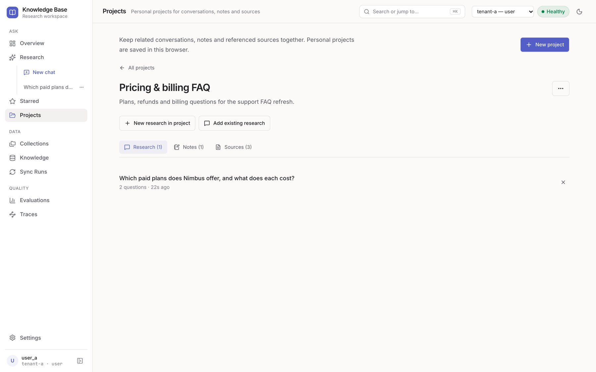
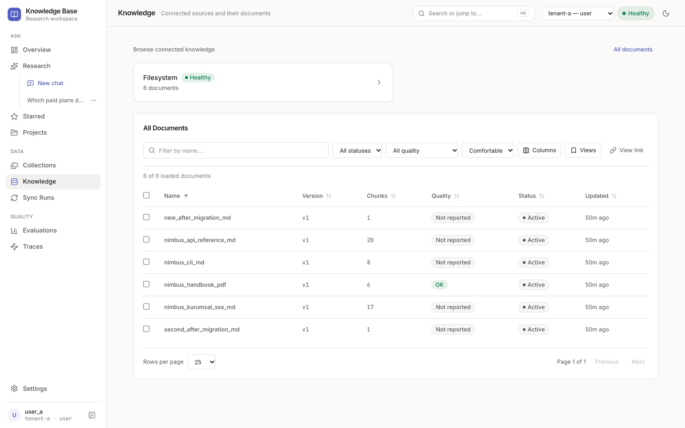
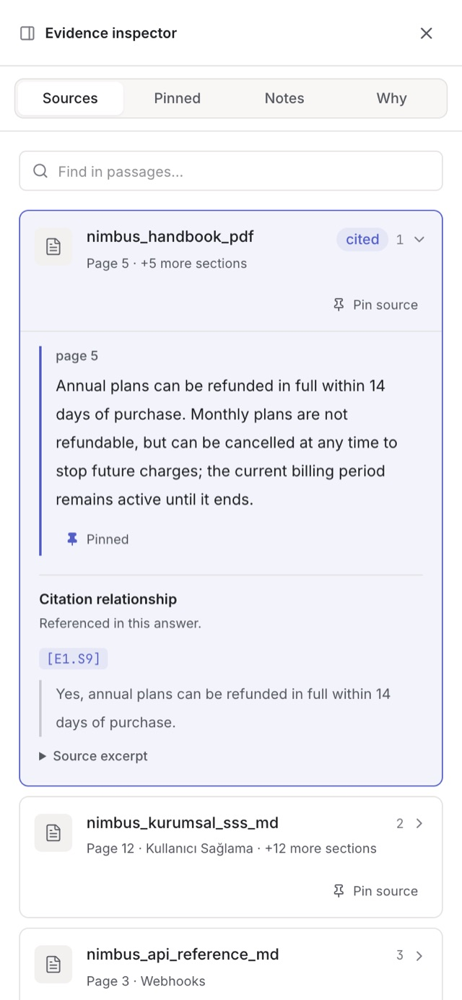
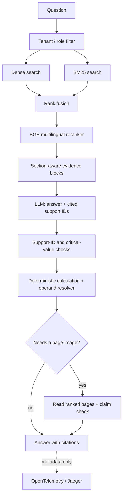

# Knowledge Base Research Workspace

Ask questions across your documents and get answers you can check: every
claim is cited to the passage it came from, calculations are recomputed
deterministically, and answers that live in a chart or a scanned table are
read from the page image itself.

**Python** · **FastAPI** · **Qdrant** · **React** · **Ollama / OpenAI / Claude** ·
**OpenTelemetry**



## Highlights

- **Research workspace.** A chat-style workspace where each answer carries
  numbered citations. Click one and the evidence inspector shows the exact
  passage, its page, and how the claim relates to it.
- **Verified citations.** The model may only cite evidence it was actually
  shown. Unknown, hidden, or cross-tenant references are rejected before the
  answer is released, and critical values (numbers, dates, versions, units)
  are checked against the cited text.
- **Calculations you can trust.** For "how much did X grow" or "what is the
  ratio" questions, the model names its operands and the server does the
  arithmetic. A resolver fills in operands the model could not find and
  refuses when the inputs are not in the evidence.
- **Answers from charts and tables.** When the text layer is not enough, the
  visual path renders the most relevant pages, reads them with an
  image-capable model, and runs a second check that the claimed value is
  really shown on the claimed page.
- **Table-aware ingestion with OCR.** PDFs keep their table structure and
  captions; scanned pages fall back to Tesseract OCR (English and Turkish).
- **Research library.** Search history, starred answers, pinned evidence,
  notes linked to a source page, projects and collections, plus Markdown
  export. The library lives in the browser and is scoped per tenant and user.
- **Inspect mode.** For each answer, see why it was produced: retrieval
  candidates, reranker scores, security decisions, timing, and the full trace.
- **Tenant-safe by design.** Tenant and role filters run on the server before
  reranking or generation; the UI is never the authorization boundary.
- **Multilingual.** Turkish and English questions work against documents in
  either language, with a multilingual reranker.

## A closer look

| Inspect an answer | Notes tied to a source page |
| --- | --- |
|  |  |
| **Retrieval and reranking** | **Projects** |
|  |  |

| Connected knowledge | On a phone |
| --- | --- |
|  |  |

## How it works



Retrieval can be scoped to the documents a question names. Evidence is packed
in document order so tables stay next to their captions. Every answer has a
trace, and normal telemetry carries metadata only: no raw questions, answers,
or evidence. See [docs/architecture.md](docs/architecture.md) and
[docs/security.md](docs/security.md) for the details.

## Quickstart

You need Python 3.11+, Docker, Node.js 22, and [Ollama](https://ollama.com)
for local models.

```bash
cp .env.example .env
ollama pull qwen3-embedding:4b
ollama pull qwen3.5:4b
docker compose up -d --build
```

```bash
cd frontend && npm ci && npm run dev
```

Open `http://localhost:5173`. The API runs on `:8000`, Qdrant on `:6333`, and
Jaeger on `:16686`. Sign in with an operator identity and run a sync from the
Knowledge page so the workspace has something to search.

For host-native backend work, run `docker compose up -d qdrant jaeger` and
then `make dev`. OCR then needs Tesseract on the host
(`brew install tesseract tesseract-lang`); the Docker image already has it.

### Optional features

Calculation checks and visual answers are off by default. Turn them on in
`.env`:

```bash
DERIVED_ANSWERS_ENABLED=true
OPERAND_RESOLVER_ENABLED=true
VISUAL_ANSWERS_ENABLED=true
```

Visual answers need an image-capable provider such as `GENERATION_PROVIDER=openai`.

## Configuration

| Setting | Default | What it does |
| --- | --- | --- |
| `GENERATION_PROVIDER` | `ollama` | `ollama`, `openai`, or `claude`. |
| `OLLAMA_MODEL` / `CLAUDE_MODEL` | `qwen3.5:4b` / `claude-haiku-4-5-20251001` | Model per provider. |
| `DERIVED_ANSWERS_ENABLED` | `false` | Server-side arithmetic for calculation questions. |
| `OPERAND_RESOLVER_ENABLED` | `false` | Finds missing operands in the evidence; needs derived answers. |
| `VISUAL_ANSWERS_ENABLED` | `false` | Reads page images for chart, table, and figure questions. |
| `RERANKER_CANDIDATE_K` / `RERANKER_TOP_N` | `20` / `5` | Candidates reranked and passages kept. |
| `CRITICAL_VALIDATOR_VERSION` | `architecture_v2` | Critical-value validator: `baseline`, `v3`, or `architecture_v2`. |
| `AUTH_ENABLED` | `true` | Token auth with tenant and role claims. |

Keys such as `OPENAI_API_KEY` and `CLAUDE_API_KEY` come from the environment.
The full list is in [`.env.example`](.env.example). Validator and pipeline
choices are server-side only; no request field can change them.

## Quality and evaluation

Changes ship only when they pass a decision rule written down before the
result is known. Rejected experiments stay in the repo next to the accepted
ones.

| Benchmark | Result | Notes |
| --- | --- | --- |
| MMLongBench-Doc (120 questions, 13 long PDFs) | **79/120 (66%)** overall; 19/21 unanswerable questions refused | [report](artifacts/mmlongbench-v2/luna-full-v3/report.md); lenient contains-match, not the official score |
| TechQA end-to-end | 70% useful answers, 2% materially incorrect | [report](artifacts/ragbench/canonical/techqa-reranker-corrected-holdout-execution-v2/) |
| Multilingual reranker selection (220 questions) | Recall@5 1.00 TR→EN and EN→TR | [decision](docs/reranking.md) |
| Citation safety (TechQA) | 0 unknown or unauthorized support IDs accepted | Deterministic contract checks |

The validator design, its occurrence ledger, and the full experiment history
are in [docs/critical-validator-architecture-v2-rollout.md](docs/critical-validator-architecture-v2-rollout.md),
[docs/research-history.md](docs/research-history.md), and
[docs/PLANNING.md](docs/PLANNING.md).

## Testing

```bash
make test
```

The backend suite (1752 passed, 4 skipped) makes no provider calls.
`make test-ollama` runs the checks that use a local model. For the frontend
(96 tests):

```bash
cd frontend && npm test && npm run typecheck && npm run lint
```

## Limitations

- Visual answers can still misread a chart, and printed page numbers that
  differ from PDF page numbers can point the visual path at the wrong page.
- The model sometimes declines a table lookup it could have answered.
  Conservative refusal is a deliberate trade-off.
- The critical-value validator checks literals, not general meaning.
- The research library is stored in the browser, not synced across devices.
- Local demo authentication is not a full production identity setup.

## Roadmap

- Map printed page labels to PDF pages for the visual path.
- Server-side research library with sharing.
- More connectors beyond the filesystem and Notion.
- Larger multilingual evaluation sets with long documents.

## Documentation

- [Architecture](docs/architecture.md)
- [Security model](docs/security.md)
- [Reranking decision](docs/reranking.md)
- [Chunking decision](docs/chunking.md)
- [Architecture decisions](docs/adr/README.md)
- [Engineering history](docs/PLANNING.md)

## License

See the repository license and notices for distribution terms.
