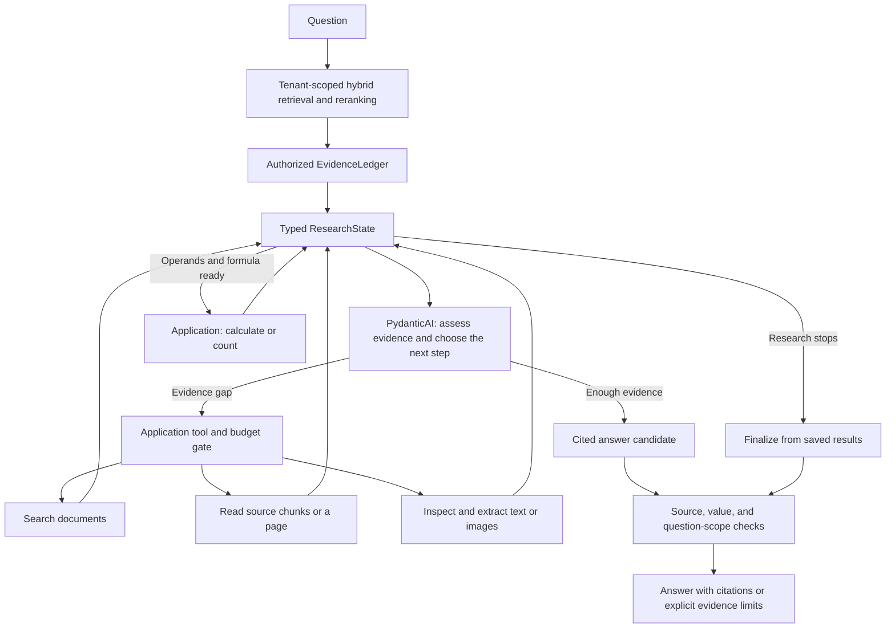
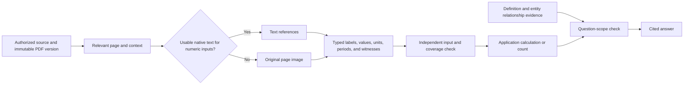

# Knowledge Base Research Workspace

**Agentic document research with PydanticAI, a typed research graph, and
answers you can trace back to their evidence.**

Ask questions across documents, complex tables, charts, and scanned PDFs.
The research workflow finds the relevant sources, collects missing evidence,
reads original page images when needed, and runs calculations in application
code. Each step operates within explicit request, token, tool, and time budgets.
Answers carry citations you can open in the research workspace.

**PydanticAI** · **Typed research graph** · **Python / FastAPI** · **Qdrant** ·
**React** · **Ollama / OpenAI / Claude** · **OpenTelemetry**

[Architecture and tool contracts](docs/adaptive-workflow.md) ·
[Answered questions](docs/adaptive-solved-questions.md) ·
[Quickstart](#quickstart)


## Agentic research, built around evidence

PydanticAI agents handle the semantic work: interpreting the question,
identifying missing evidence, choosing source regions, extracting data, and
checking whether the result answers the question. The application controls
state, graph transitions, tool permissions, calculations, and stopping rules.

- **A short path for direct questions.** When the available text answers the
  question, the workflow can produce and check the answer without entering a
  research tool loop.
- **Focused research for missing evidence.** Search the authorized index,
  open a source page, inspect its structure, or extract a table. Each operation
  addresses a concrete evidence gap.
- **Original images for visual data.** Quantitative reads of image-only PDF
  pages are routed to the original page image. Category, series, period, unit,
  and label–value relationships stay attached to the extracted inputs.
- **Operation-specific contracts.** Direct value reads, arithmetic, counts,
  extrema, and lists expose only their own fields. Computed answers retain
  reviewed output units and explicit interpretations.
- **Application-owned working state.** `ResearchState` stores typed evidence,
  checked inputs, calculations, unresolved issues, and provenance. Each agent
  receives a task-specific projection of that state.
- **Deterministic maths.** Prepared operands and formulas run directly in
  application code. Arithmetic, item counts, and total-versus-distinct
  comparisons do not require another model to invent the result.
- **Independent finalization.** Research can stop while successful extraction
  and calculation results remain available for the final answer and checks.

### The research graph



This is an application-controlled research graph using typed PydanticAI agent
calls. Prepared calculations and known transitions can execute directly; the
model is called where a semantic decision is needed.

### Narrow tools, clear responsibilities

| Operation | Responsibility | Boundary |
| --- | --- | --- |
| Search | Find missing passages in the authorized document scope. | Cannot expand tenant access or write an answer. |
| Read | Open admitted chunks or a bounded physical PDF page. | Keeps source identity, version, headings, and page context. |
| Inspect | Locate PDF tables, image regions, and structural elements. | Does not claim an exhaustive semantic figure inventory. |
| Extract / collect inputs | Return structured values or item inventories with source witnesses. | Cannot guess unreadable values, calculate the result, or write the final answer. |
| Calculate / count | Execute a permitted formula or count checked source items. | Requires source-backed inputs; no arbitrary code execution. |

The application validates tool arguments and source access before execution.
Numeric sources and contextual sources are tracked separately, so a table value
can travel with the evidence explaining which entity or definition it belongs to.

### From a table cell to a checked answer



OpenTelemetry spans connect retrieval, evidence admission and selection,
source inspection, extraction, computation, validation, and release. They make
it possible to locate where a value was lost, misread, or rejected.

## Workspace and platform features

- **Research workspace.** A chat-style workspace with numbered citations.
  Open a citation to inspect the passage, page, and claim relationship.
- **Verified source references.** The model can cite only evidence it was
  shown. Unknown, hidden, or cross-tenant references are rejected before release.
- **Table-aware ingestion with OCR.** PDFs preserve table structure and
  captions; scanned pages can use Tesseract OCR in English and Turkish.
- **Research library.** Search history, starred answers, pinned evidence,
  source-linked notes, projects, collections, and Markdown export. Browser
  storage is scoped per tenant and user.
- **Inspect mode.** Retrieval candidates, reranker scores, security decisions,
  stage timing, and trace details sit alongside the answer.
- **Tenant and role isolation.** Server-side access filters apply before
  reranking and generation. Tool calls recheck authorized sources and versions.
- **Multilingual retrieval.** Turkish and English questions work against
  documents in either language with multilingual embeddings and reranking.

## A closer look

| Inspect an answer | Notes tied to a source page |
| --- | --- |
|  |  |
| **Retrieval and reranking** | **Projects** |
|  |  |

| Connected knowledge | On a phone |
| --- | --- |
|  |  |

## Retrieval and trust boundaries

Tenant and role filters constrain dense and BM25 search. Rank fusion and BGE
reranking select source passages, and section-aware assembly keeps tables near
their headings and captions. The agentic layer builds on this evidence pipeline.

The original question defines the requested scope. Retrieved content is
untrusted data, and gold answers are excluded from runtime generation and
verification. Source identity and access checks run in code; numerical checks
and semantic scope checks address different failure modes.

Normal telemetry carries bounded metadata. Raw questions, answers, evidence,
and model outputs require explicit forensic capture settings. Local raw run
files are ignored by Git; small Markdown reports record the outcomes.

See [system architecture](docs/architecture.md),
[research workflow](docs/adaptive-workflow.md), and
[security](docs/security.md).

## Quickstart

You need Python 3.11+, Docker, Node.js 22, and [Ollama](https://ollama.com)
for local models.

```bash
cp .env.example .env
ollama pull qwen3-embedding:4b
ollama pull qwen3.5:4b
docker compose up -d --build
```

```bash
cd frontend && npm ci && npm run dev
```

Open `http://localhost:5173`. The API runs on `:8000`, Qdrant on `:6333`, and
Jaeger on `:16686`. Sign in with an operator identity and run a sync from the
Knowledge page so the workspace has something to search.

For host-native backend work, run `docker compose up -d qdrant jaeger` and
then `make dev`. OCR needs Tesseract on the host
(`brew install tesseract tesseract-lang`); the Docker image includes it.

### Agentic research profile

Enable the typed research graph in `.env`:

```bash
ADAPTIVE_RAG_ENABLED=true
AGENTIC_RAG_ENABLED=false
ADAPTIVE_FAST_PATH_ENABLED=true
ADAPTIVE_EVIDENCE_NEEDS_ENABLED=true
SUPPORT_IDS_ENABLED=true
DERIVED_ANSWERS_ENABLED=true
VISUAL_ANSWERS_ENABLED=true
```

Configure an image-capable model and credentials for visual reads. Provider
selection is independent of the graph; see [`.env.example`](.env.example).
The adaptive and alternative agentic runner flags are mutually exclusive.

The recent document runs used 10 model requests, a 120,000-token ceiling,
a 240-second deadline, at most six research tool attempts, and a 60-second
finalization reserve. These are configurable limits; their complete profile is
in the [workflow documentation](docs/adaptive-workflow.md#budgets-and-finalization).

## Configuration

| Setting | Default | Purpose |
| --- | --- | --- |
| `ADAPTIVE_RAG_ENABLED` | `false` | Typed, state-driven agentic research graph. |
| `ADAPTIVE_FAST_PATH_ENABLED` | `false` | Try a supported answer before opening a research loop. |
| `ADAPTIVE_EVIDENCE_NEEDS_ENABLED` | `false` | Track question-bound evidence needs and source selection. |
| `GENERATION_PROVIDER` | `ollama` | `ollama`, `openai`, or `claude`. |
| `DERIVED_ANSWERS_ENABLED` | `false` | Source-backed arithmetic, counting, label selection, and list ordering. |
| `VISUAL_ANSWERS_ENABLED` | `false` | Original-page image reading and input checking. |
| `AGENTIC_MAX_REQUESTS` / `AGENTIC_MAX_TOKENS` | `6` / `60000` | Shared model usage ceilings. |
| `AGENTIC_MAX_TOOL_CALLS` / `AGENTIC_TIMEOUT_SECONDS` | `8` / `120` | Tool and end-to-end time ceilings. |
| `AGENTIC_RESEARCH_POLICY` | See `.env.example` | Research steps, retries, timeouts, and finalization reserve. |
| `ADAPTIVE_FINAL_REASONING` | `medium` | Effort for final interpretation, source selection, and semantic checks. |
| `RERANKER_CANDIDATE_K` / `RERANKER_TOP_N` | `20` / `5` | Candidates reranked and passages kept. |
| `CRITICAL_VALIDATOR_VERSION` | `architecture_v2` | Claim-local critical-value validation. |
| `AUTH_ENABLED` | `true` | Token authentication with tenant and role claims. |

Credentials come from the environment. Pipeline selection and research budgets
are server-side settings; user requests cannot widen them.

## Quality and evaluation

The [answered-question ledger](docs/adaptive-solved-questions.md) records each
source-supported result once, with its run, answer, latency, and model-call count.

| Evaluation | Result | Scope |
| --- | --- | --- |
| Agentic question coverage | **120 distinct questions tried: 74 source-correct answers, 1 qualified calculation, 4 verified refusals, 41 unresolved** | [Answered questions and evidence](docs/adaptive-solved-questions.md); historical results across development revisions. |
| Earlier MMLongBench-Doc pipeline | **79/120 (66%)**; 19/21 unanswerable questions refused | [Report](artifacts/mmlongbench-v2/luna-full-v3/report.md); lenient contains-match, not the official score. |
| TechQA HOLDOUT50 | **26/50 (52%)** useful on the evaluated production path; 2% materially incorrect | [Report](artifacts/ragbench/techqa-production-v1/report.md); a separate pipeline evaluation. |
| Multilingual reranker selection | Recall@5 1.00 TR→EN and EN→TR, 220 questions | [Decision](docs/reranking.md). |

The agentic total counts each question once; reruns do not increase coverage.
Historical results across revisions are not a full current-version benchmark
or a stability estimate. Successful abstention is evaluated separately from
answerable-question accuracy; an operational stop is not evidence that the
answer is absent. Failed runs remain in the local history and report summaries.

## Testing

```bash
make test
make lint
```

The latest recorded backend run passed **2,125 tests**, with four skips and
five deselected tests. The normal suite makes no paid provider calls.
`make test-ollama` runs the checks that use a local model.

```bash
cd frontend
npm test
npm run typecheck
npm run lint
npm run build
```

## Current boundaries and next steps

- Image reading and semantic judges can still make mistakes. Native-text
  inspection identifies image-heavy pages; it is not a universal OCR accuracy score.
- Broader document-held-out evaluation and repeated runs are needed to measure
  answer coverage, incorrect acceptance, unnecessary refusal, and stability.
- `ResearchState` is typed and serializable; automatic cross-request checkpoint
  recovery and long-term memory are separate persistence work.
- The research library currently lives in browser storage.
- The repository's local demo authentication is not a complete identity platform.

## Documentation

- [Agentic workflow, graph, tools, and budgets](docs/adaptive-workflow.md)
- [Answered questions and run summaries](docs/adaptive-solved-questions.md)
- [System architecture](docs/architecture.md)
- [Design rationale and roadmap](docs/adaptive-rag-research-design.md)
- [PydanticAI orchestration research](docs/pydantic-workflow-research.md)
- [Semantic validation and evaluation](docs/rag-validation-research.md)
- [Security model](docs/security.md)
- [Reranking decision](docs/reranking.md)
- [Chunking decision](docs/chunking.md)
- [Architecture decisions](docs/adr/README.md)
- [Engineering history](docs/PLANNING.md)

## License

See the repository license and notices for distribution terms.
