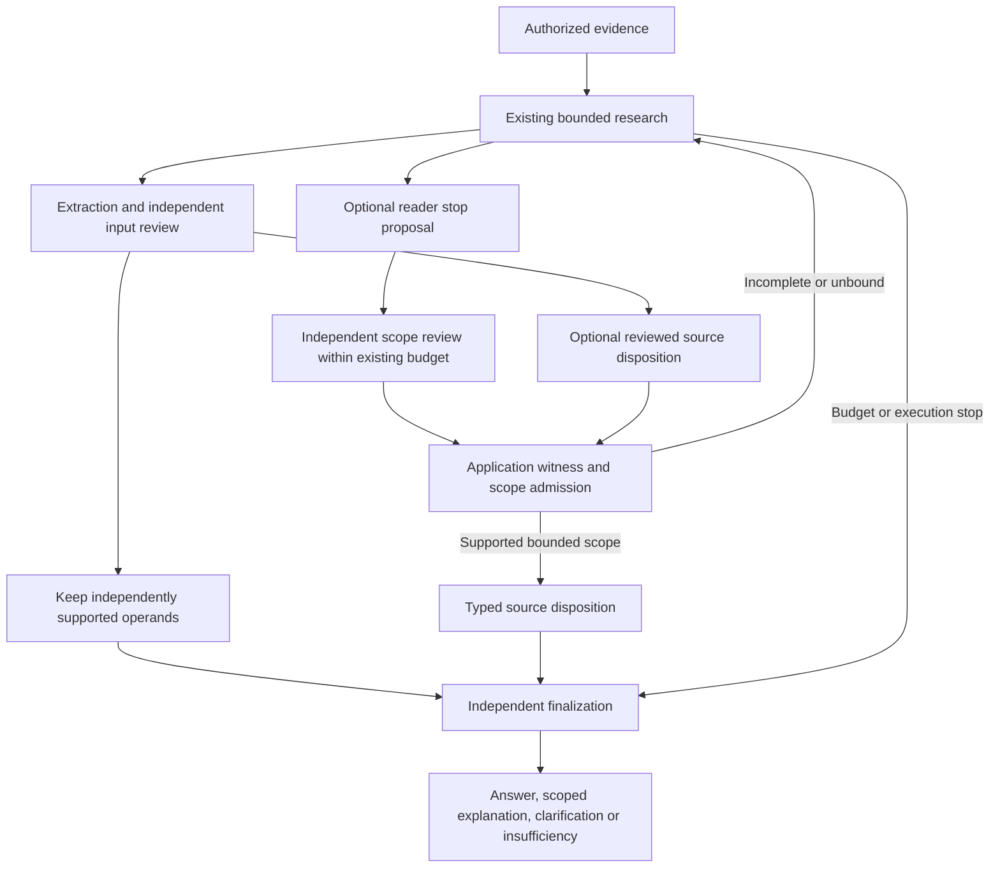

# Scoped source dispositions and preservation of partial inputs

Date: 21 October 2026. Follow-up to the
[thirteen-question audit](../adaptive-negative-thirteen-audit-20261020/REPORT.md).

## Change

Research execution stops and source findings now have separate typed records. A
budget stop is still an execution stop; it never becomes proof of missing data.
The application retains `DispositionReceipt` records in `ResearchState`, including
the original question, independently reviewed proposal, immutable source/version,
physical page, literal or image-checked witnesses, object boundaries, pending
candidates, admission diagnostics and checked partial values.

The effective dispositions are `source_conflict`, `not_reported_in_scope`,
`needs_clarification` and `insufficient_evidence`. Only an admitted, current receipt
can produce a stronger explanation. The model proposes source semantics; it does
not write or replace ResearchState.

## Admission and finalization boundaries

- Match the proposal to the original question and bind witnesses to current,
  authorized, versioned support units. Text quotations must be literal. Image
  witnesses require the exact immutable page supplied to the independent checker.
- Verify question binding and source-object identity separately. A generic coverage
  flag cannot replace these checks. Missing is not zero; publication year is not
  observation year. A qualified correction can remain a material answer.
- A strong negative requires independently supported question/object bindings,
  complete relevant scope, excluded alternatives, visible boundaries and no pending
  candidates. A material available answer blocks negative finalization.
- **Whole-document absence remains unestablished by a bounded receipt.** Document
  claims are downgraded to insufficiency until an application-owned multi-window
  closure manifest exists. Inspecting three pages or exhausting a search does not
  close a PDF. A bounded object can still support an explicitly object-scoped finding.
- A successful extraction, satisfied need or checked computation takes priority.
  Newly acquired evidence invalidates automatic reuse of an earlier negative receipt;
  the old receipt remains intact for audit. Existing authorization checks also run
  at release. A receipt cannot be reused for another question or document version.
- The existing quantity checker can supply a reviewed disposition without another
  review request. A reader's new stop proposal gets one independent scope review
  inside existing research limits. Ordinary generic stopping needs no new review.
- Checked reasons finalize deterministically; no LLM call is needed to paraphrase
  them. Clarification uses the existing clarification response. Release still records
  abstention rather than fabricating a supported answer or modifying a gold label.

## Partial numeric inputs

The quantity assessment independently identifies supported operands even when a
second input is missing. Application admission filters out unavailable, invalid or
explicitly disputed operands. The record and bounded model context retain the
checked source values, labels, units and scales; the incomplete formula is not
executed. Finalization can use these values after research stops.

For the audited tweet-difference pattern, the available company count must survive
while the missing company's count remains null. A verified object-scoped explanation
can include the retained count and explicitly state that no result was calculated
from missing inputs. A different company's row, an aggregate hashtag curve and zero
are not substitute operands.

Legacy accepted `not_found` reads keep their safe abstention behavior. Their new
`absence_scope` is `inspected_material` unless an independently admitted bounded-object
receipt establishes more. The legacy `absence_confirmed` boolean is not a whole-PDF
certificate. It is retained for compatibility, with explicit scope in the record and
checked transcription.

## Observability and regression

`research.disposition.admit` spans expose receipt ID, effective kind, verification
status, diagnostic codes and witness support IDs. Root spans count source dispositions
and preserved partial inputs. Full source witnesses remain in local forensic state;
model context omits the application's evidence snapshot ID list.

Offline regressions cover local-to-global absence errors, unknown object identity,
unread continuations, invalid witnesses/pages, changed source versions, successful
work taking priority, stale receipts after acquisition, exact supplied image pages,
reader/checker handoff, partial-input finalization, clarification after budget stop
and authorized release. A delayed-match regression starts with a 2013 table, rejects
a premature negative, continues research and publishes the later 2020 observation.
No question IDs, expected values, company aliases or dataset-specific rules enter
runtime code.

## Measurement and accounting

The first frozen live selection is **728, 730, 380, 1017**, in that order, sequential.
The first pair checks negative/partial-input behavior; the second pair controls
answerable income/debt calculations. All application Python files and the existing
harness are hashed before and after each row. Main generation never sees benchmark
labels or reference pages. The same gpt-6-luna profile, ten main requests, 120,000
tokens and 240-second main limit remain in effect. Embedding, index, retrieval,
reranking, ingestion and global request/tool/time ceilings are unchanged.

The initial frozen batch completed with unchanged source hashes:

| Row | Released result | Run seconds | Main requests | Source/trace finding |
| --- | --- | --- | --- | --- |
| 728 | Insufficient evidence | 121.62 | 9 | Inspects pp. 19 and 18/19, rather than the corporate table on p. 16. The 60,000 hashtag total is rejected as an input; no operand is certified. No source disposition is generated. |
| 730 | Insufficient evidence | 31.54 | 6 | Repeated bounded searches end in no progress. No stronger absence claim or source disposition is generated. |
| 380 | **8,367,277,000 rupees** | 50.11 | 6 | Both printed operands and source scale are independently checked; calculation remains correct. |
| 1017 | Insufficient evidence | 95.66 | 9 | **799, 6,692 and 2,642** survive as independently supported inputs; current operating and finance lease inputs remain unavailable. The total is not computed. |

These observations establish partial-input retention in a live failure and a retained
correct calculation. They do **not** establish an end-to-end source-disposition
recovery: no new source-disposition receipt is generated by these four runs.

No historical total is promoted by a new schema or an offline fixture. The ledger remains **79 supported /
2 qualified / 4 verified refusals / 35 unresolved**, across 120 distinct questions,
unless a separately source-audited live result justifies a change.

Raw JSON, spans, captures, logs and source snapshots remain local and ignored. API
pricing for gpt-6-luna is not configured, so dollar cost is unknown rather than zero.

## Fresh-page binding follow-up

The initial 1017 trace exposes a general acquisition problem: a text-to-image change
on the old page window is accepted before the search's other candidate pages are
considered. A full three-page window can also exclude a newly found page even when
some old pages are irrelevant to the independently supported operands.

Gap binding now prioritizes candidate pages outside the prior inspected window.
When an image window would overflow, the application can replace irrelevant pages
with the new candidate while retaining **every independently supported prerequisite
page**. If the retained prerequisites plus the candidate cannot fit, the existing
hard limit applies. Earlier records remain intact. Selection locates candidates;
collection and independent review still decide whether their contents are relevant
and correct. There is no document-specific page or accounting rule.

Repeated identical reader disposition proposals over identical evidence reuse their
prior check. New evidence permits another check. A superseded quantity assessment
cannot silently reuse an earlier negative receipt. These are application-level
reuse/invalidation rules, not retries to obtain a preferred semantic verdict.

The next frozen sequence is **508, 830, 1017, 380**, sequential, in `follow-up/`.
It checks a textual missing-field case, clarification and the acquisition correction
with an answerable arithmetic control. The completed results are:

| Row | Released result | Run seconds | Main requests | Finding |
| --- | --- | --- | --- | --- |
| 508 | Insufficient evidence | 49.38 | 4 | The model writes a source-consistent missing-field explanation. Positive requirement checking cannot bind the absent target; the next abstention discards the explanatory draft. No verified disposition is retained. |
| 830 | Finalization failure | 61.91 | 9 | A valid clarification question is present in the final draft alongside non-abstaining answer fields; exclusive-outcome validation rejects the mixed shape. An unsupported imported 9:30 opening time is withheld earlier. |
| 1017 | Finalization failure | 119.52 | 9 | General research finds the lease note and the correct 11,407 formula. Two reader drafts combine an answer and prepared plan; finalizers then use noncanonical comma expressions. The numeric total is not published. |
| 380 | **8,367,277,000 rupees** | 48.74 | 6 | Correct calculation retained. |

The window correction is covered offline but is not exercised by this 1017 live
attempt: collection produces no record and general research finds the note. No
causal recovery is assigned to an unexercised branch.

## Outcome handoff correction

The follow-up exposes reusable transport/orchestration defects rather than a need
for stricter answer wording:

- An explicitly typed clarification now wins over accompanying answer fields. The
  application clears the draft without asking the model to perform that formatting.
- A single prepared plan accompanying an answer executes before publication. Two
  competing plans remain invalid. Application arithmetic, source checks and independent
  semantic scope checking remain authoritative.
- Completed text calculations reuse their canonical application proof at finalization;
  the model does not need to rewrite the formula or result with display separators.
- A parser page read can include overlapping chunks spanning more than three pages.
  Its requested page is only a hint. Bounded quality inspection may use that hint only
  when immutable original native pages jointly support **every** calculation input.
  A missing native input, absent hint, incomplete native view or inaccessible snapshot
  keeps the conservative inspection contract. Source units are not relabeled or
  shortened; semantic source/period/unit review still runs.
- Existing independent scope checking can return a typed source finding when a
  positive requested-value binding fails. An absent target need not appear first in
  a complete relevant object. The original positive binding remains unknown; an
  independently grounded source finding is a separate outcome. Source line locators
  let the application preserve exact quotations without model rewriting.

The frozen sequence in `outcome-handoff/` completed as **508, 830, 1017, 380**,
with unchanged application/harness hashes:

| Row | Released result | Run seconds | Main SDK requests | Finding |
| --- | --- | --- | --- | --- |
| 508 | Insufficient evidence | 126.96 | 9 | Research turn limit; no typed source disposition is generated. |
| 830 | Clarification | 26.96 | 4 | Typed clarification survives normalization. Token-only benchmark export has an empty answer; offline replay of the captured draft verifies the production clarification event. |
| 1017 | Finalization failure | 135.77 | 8 | Three checked inputs survive. Repair collection times out at 60.01 seconds; the complete lease note is not in final visible evidence. A qualified 10,133 subtotal does not establish the requested total. |
| 380 | **8,367,277,000 rupees** | 52.32 | 6 | Correct calculation retained. |

All twelve runs across the three batches produce zero typed source-disposition
receipts. This does not mean twelve wrong answers: 380 succeeds three times and
the latest 830 clarifies. No end-to-end source-disposition recovery is established.
The [lifecycle audit](AUDIT.md) traces the optional production paths, positive
requirement/outcome mismatch, incomplete acquisition and clarification export gap.
Its proposed corrections are not implemented by the documentation-only audit.

The implementation passes **2,368 tests**, with four skipped and five deselected.
Ruff passes; mypy passes 162 files. Historical ledger totals remain unchanged.

## Terminal assessment follow-up

The [terminal finalization attempt](terminal-finalization/REPORT.md) did not recover
its live targets. Its added source-proposal schema and mandatory abstention
handoff have been removed. The [current answer-local correction](answer-local-validation/REPORT.md)
allows separately validated calculations past the broad failed-collection veto,
while retaining normal source/arithmetic/scope checks. It adds no model loop;
clarification export and typed observability receipts remain. It passes 2,381
tests. Missing-input acquisition, source-disposition production and document-wide
closure remain open. Earlier measurements above are retained unchanged.
