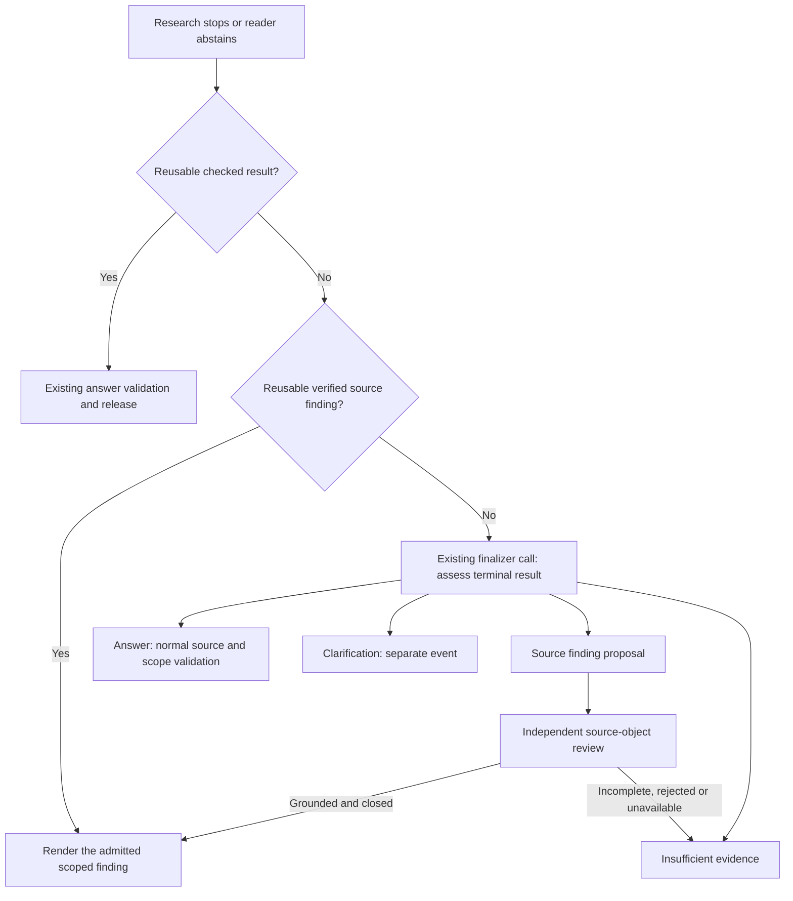

# Terminal source assessment and clarification export

Historical attempt: the finalizer source-proposal schema and mandatory
abstention-to-finalizer handoff described below were subsequently removed. The
[current answer-local correction](../answer-local-validation/REPORT.md) keeps
normal answer validation and introduces no extra judge loop. Clarification export
and application-owned observability receipts are retained.

21 October 2026. Follow-up to the [lifecycle audit](../AUDIT.md).

## Change

Finalization can now propose a typed source finding as its terminal result. The
application automatically dispatches independent source review using the existing
scope model and shared finalization limits. A missing requested value is not
required to pass positive-answer binding before this separate review can run.

This reuses the existing finalizer call rather than adding a preliminary summary
call. Existing verified findings are reused without another finalizer/reviewer
request. New findings require independent review; successful calculations retain
priority and their normal publication checks.

An abstaining reader no longer bypasses finalization. Failed collection also no
longer bypasses terminal assessment simply because its source IDs are unchanged.
Research stays closed: no new retrieval or tools are dispatched by this phase.

## State, safety and budget

- `ResearchState.terminal_assessments` contains application-constructed typed
  outcome receipts, evidence snapshot IDs, retained partial quantity IDs and
  diagnostic codes. It is not a model-written research summary.
- A verified fact alone is not proof that the entire question is answered. All
  planned needs must be satisfied before their status suppresses a source finding.
  Independently checked partial values remain available and can accompany a
  verified finding from the same source/version.
- Source findings retain exact question/source binding, independent semantic
  review, literal witnesses, object boundaries and source-version checks.
  Incomplete inspection and document-wide claims remain insufficiency. Whitespace
  is not a valid question or source witness.
- Terminal source review uses the finalization deadline, not the expired research
  deadline. It shares existing hard request/token/time limits. The existing
  two-request finalizer/validation reserve can complete proposal plus review.
  Review or finalizer budget exhaustion preserves checkpoints and produces safe
  insufficiency, not evidence of absence or a published unchecked proposal.
- Spans record `research.terminal_outcome`, the admitted disposition ID, partial
  quantity record IDs and diagnostic codes. Main telemetry exposes the terminal
  outcome. No raw evidence is added to operational span attributes.

No embedding, retrieval, reranker, parser, global budget or reasoning-effort
changes are included. Missing-input acquisition is still a separate open task;
this change does not claim to recover the latest incomplete 1017 total.

## Evaluation export

The trace harness now records `terminal_kind` and the explicit `clarification`
event, separately from joined answer tokens. Empty tokens are preserved as empty
tokens rather than filled with an invented answer. Rendered insufficiency is not
classified as a positive answer merely because text was streamed.

The existing captured 830 clarification was replayed through the export helper
offline: `terminal_kind=needs_clarification`, empty `answer`, and “Which market
are you asking about?” with its original options. No paid call was needed for
this export check.

## Verification

**2,382 tests passed**, four skipped, five deselected. Ruff passes and mypy passes
163 application files. Regressions cover abstaining-reader handoff, closed versus
incomplete object review, the existing two-request reserve, expired research with
live finalization budget, unavailable independent review, retention of partial
work, and explicit clarification export. Existing positive calculations and
delayed-match tests remain included.

## Live measurement

The frozen sequential selection is **508, then 380**, under the unchanged
gpt-6-luna diagnostic profile, fast path and evidence needs. All application Python
and the trace harness are hashed before and after each run. The first row targets
the missing-field lifecycle; the second is the answerable arithmetic control.
Both runs completed with unchanged source hashes. Neither establishes recovery:

| Row | Terminal result | Run seconds | SDK requests | Finding |
| --- | --- | --- | --- | --- |
| 508 | Insufficient evidence | 46.39 | 6 | Finalizer returns no source-finding proposal. The new route is available but does not produce a checked finding. |
| 380 | Finalization failure | 57.19 | 9 | First finalizer has the correct canonical 8,367,277,000 calculation. Unresolved quantity-review evidence prevents release; the next draft rewrites arithmetic with display separators. |

These results do not demonstrate an improvement. No ledger totals are promoted.
In response to the complexity review, no additional terminal assessor or model
loop was implemented. The next design review should prioritize removing broad
workflow vetoes and clarifying existing outcome contracts before adding calls.

Raw JSON, captures, spans, source hashes and logs remain local and ignored. Model
dollar pricing is not configured, so dollar cost remains unknown.
