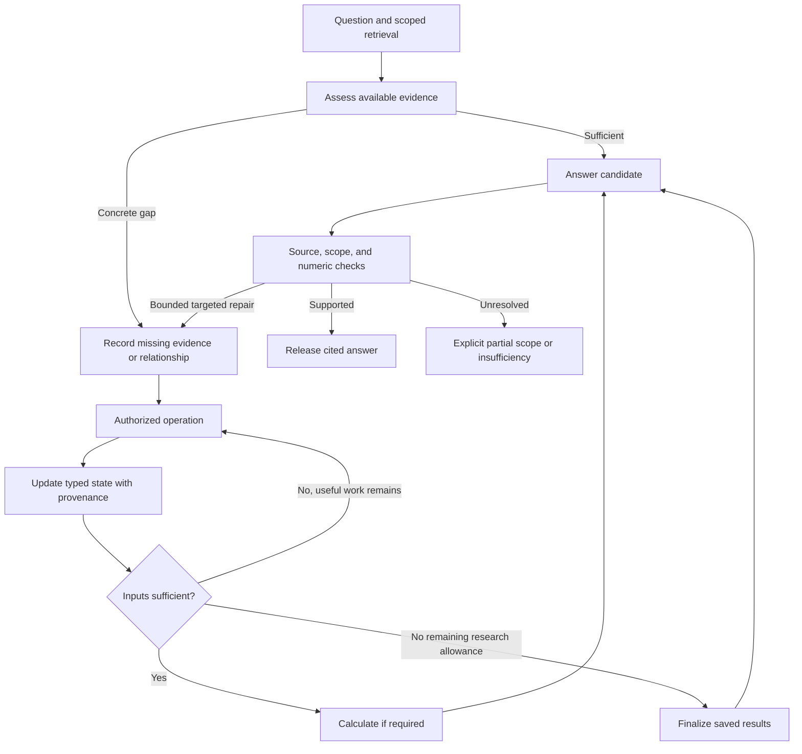

# Adaptive RAG: tools, working state, and semantic verification

Research recorded: 18 October 2026. Implementation mapping updated: 19 October 2026.
This document explains the architecture and its design decisions. The
[workflow](adaptive-workflow.md) documents implemented contracts; the
[answered-question ledger](adaptive-solved-questions.md) documents measured runs.
Persistence and framework options below are design choices, not additional
runtime capabilities implied by the existence of a dependency.

## Product objective

Answer from the available text when it is sufficient. When a table, chart, or
source relationship is missing, read the relevant evidence, preserve its structure,
perform any required computation, and produce a natural answer with citations.
The same tool contracts should work across collections without hidden rules for
particular benchmark rows.

The objective is more sufficient, correct, source-supported answers within an
acceptable error level, latency, and cost. Increasing refusal alone can reduce
published errors while making the product less useful. Increasing acceptance
alone can hide unsupported answers.

## Failure model

Repository investigations identified distinct failure locations:

1. Retrieval finds the document, but the model-visible representation loses a
   label, value, heading, visual relationship, or source qualifier.
2. The inputs are available, but generation or checking chooses the wrong entity,
   period, quantity, or operation.
3. A correct or recoverable result is lost through validation, tool access,
   presentation, or budget control flow before reaching the user.

An offline agent-loop reproduction found successful calculations followed by an
application abstention because no new text block had been added. That demonstrated
a control-flow defect, not its prevalence in live traffic. Later document runs
also separated OCR transcription errors from unnecessary scope rejection.

Gold answers are useful evaluation references. They must not become runtime
instructions or the only accepted wording. Correcting a dataset label and
improving a model are different changes and must be reported separately.

Related records: [tools](research-tools.md), [budget audit](agentic-budget-audit.md),
[engineering history](PLANNING.md), [validation research](rag-validation-research.md),
and [PydanticAI orchestration research](pydantic-workflow-research.md).

## Architectural invariants

- **Application-owned state.** `ResearchState` is typed application data, not an
  LLM-written summary. Models propose needs, plans, and observations; the
  application validates and stores them with source bindings.
- **Direct execution where possible.** Ready operands and a permitted formula
  can execute without another model decision. Direct and model-mediated actions
  share authorization, validation, and accounting.
- **Independent finalization.** Successful extraction and calculation results
  survive research closure. Finalization uses reserved allowance within the same
  hard request/token/time ceilings. Cancellation or provider failure remains an
  operational outcome, not evidence of source absence.
- **Question-specific work, shared policy.** Decisions depend on the question,
  evidence, capabilities, and budget rather than a collection name or gold label.
- **Preserved relationships.** Values retain category, series, period, unit,
  scale, qualifier, and source identity. A lossy summary is not their sole copy.
- **Flexible expression, strict meaning.** Equivalent wording is acceptable;
  wrong entities, periods, populations, scales, or units are material defects.
- **Observable progress.** Useful reads, checked bindings, resolved ambiguity,
  and successful computations count as progress even without new text blocks.

## Overall graph

Application code controls the outer workflow. Small typed agent calls handle
semantic uncertainty inside the stages. A supervising model does not need to
replan every deterministic transition.

Every loop checks remaining allowance, evidence revision, repeated action
signatures, and the finalization reserve. First assessment and answer preparation
can share a model call. A separate router is not mandatory for every question.
The implementation currently uses explicit async control flow with PydanticAI
calls; GraphBuilder is an orchestration option rather than a required runtime.

## Decision boundaries

| Responsibility | Owner | Example |
| --- | --- | --- |
| Semantic need | Model | Which period, definition, or table relationship is missing? |
| Executability and trust | Application | Is the source authorized, versioned, bounded, and within budget? |
| Invocation mechanics | PydanticAI and application dispatcher | Typed arguments, outputs, tool execution, and hand-offs. |

A typed `Ready`, `NeedMoreEvidence`, `NeedRegion`, `NeedCalculation`, or
`NeedClarification` proposal is still a semantic hypothesis. Its schema validity
does not establish that the routing choice is correct. Route accuracy must be
measured alongside answer quality.

## Tool catalog

| Responsibility | Input and output | Boundary |
| --- | --- | --- |
| Search evidence | Query and narrowing scope → passages, page candidates, scan limits. | No final answer or expanded access. |
| Read document | Authorized document/version and region → text with headings and context. | No unrestricted filesystem or collection traversal. |
| Inspect page | Authorized page → structural table/image/caption candidates. | No claim of complete semantic figure detection. |
| Extract data | Source page/region → values, labels, units, relationships, footnotes, unreadable fields. | No answer writing, arithmetic, or guessing. |
| Calculate | Evidence-bound inputs and permitted expression → result and computation receipt. | No invented operands or arbitrary code. |

These can be functions or small toolsets. Tool count itself is not a design goal;
clear responsibilities reduce semantic selection ambiguity. A separate tool for
every cell would create unnecessary routing work.

Extraction can use parser text, OCR, or a visual model behind the same external
contract, with the method recorded. A model must be able to request original
images for a justified evidence gap; visual keywords are not a complete router.
Results distinguish success, partial coverage, unreadable data, bounded not-found,
and operational error. Missing results do not prove absence outside the inspected
scope. Final answer generation and release checking remain application stages.

## Typed data contracts

These are application models, not built-in RAG schemas supplied by the SDK.

| Contract | Information to retain |
| --- | --- |
| Task | Original question, requested entity/period/population, subquestions, operation, units, precision, ambiguity. |
| Evidence reference | Tenant, source ID, immutable version/hash, physical page, region, support ID. |
| Extraction | Raw and canonical value, row/column headings, category, series, unit/scale, footnote, readability, method, source reference. |
| Computation plan | Permitted formula, definition source, named inputs bound to evidence. |
| Computation result | Inputs, conversion, operation, rounding, result, and unit. |
| Answer draft | Natural wording, claim/citation bindings, and explicit scope limits. |
| Review | Source support, question scope, numeric status, materiality, missing evidence, contradiction, and diagnostic error. |

The original question is immutable. Interpretations can be versioned and explained;
the model cannot silently replace the task with an easier one. Python objects
can move directly between stages; models receive only the required serialized
projection, without internal clients, credentials, or unlimited history.

For example, a request for the combined length of two 2024 lines in meters can
extract 120 cm and 2 m with their original periods and units, convert and add in
code, and answer 3.2 m. A request for their difference in centimeters changes the
computation plan, not the underlying extracted source values.

## Working state, checkpoints, and caches

Working state records what is known, missing, attempted, computed, or disputed
for this question. Tool results update it directly; no summarizer call is needed
at every step. Model assumptions, checked facts, extraction errors, and failed
searches must have distinct statuses. Invalidating an input also invalidates
results depending on it.

| Layer | Purpose | Design boundary |
| --- | --- | --- |
| Working state | Coherent progress within a question. | Required; implemented as typed application state. |
| Checkpoint | Inspection and continuation after interruption. | Save state/schema versions, sources, pending work, continuation point, and consumed allowance. |
| Extraction cache | Avoid repeating the same region extraction. | Add after measuring repetition and invalidation requirements. |
| Long-term memory | Preferences or reviewed information across sessions. | Separate purpose and data lifecycle; not a prerequisite for research. |
| Durable execution | Recovery from process or mid-step failure. | Separate operational architecture decision. |

Resume must revalidate access and document versions without resetting spent
allowance. A checkpoint does not imply exactly-once API execution or side effects.
Extraction cache keys include source hash/version, region, render settings, model,
prompt/schema versions, and any question/context affecting the extraction.
Cache hits cannot bypass authorization. Previous model answers and gold answers
must not be written as verified shared document knowledge.

## Strict and flexible constraints

| Topic | Policy |
| --- | --- |
| Tenant, user, and source authorization | Enforced in code; the model cannot widen it. |
| Source identity/version and page bounds | Rechecked before execution and use. |
| Unreadable or absent values | Remain unreadable/unknown; no guesses. |
| Entity, period, population, series, and condition | Material semantic requirements. |
| Wording, translation, sentence order | Flexible unless the user specifies a format. |
| Units and scale | Equivalent transformations are allowed when dimensions and meaning remain intact. |
| Currency | Requires an exchange rate, date, and source. |
| Percentage versus percentage points; stock versus flow | Not silently equivalent. |
| Rounding | Depends on requested precision and source resolution. |
| Product IDs and versions | Not blindly normalized as decimal numbers. |
| Tool choice and reasoning path | Flexible within permission, capability, relevance, and cost boundaries. |

Collection independence does not erase domain definitions. Use the source's
meaning of EBITDA, debt, or sales; disclose material ambiguity or request
clarification. Never select a hidden definition from a benchmark row or gold label.

## Bounded research and finalization

Each action should have a concrete information gap, a plausible way to address
it, an observable state change, and remaining allowance. New evidence, corrected
readings, verified bindings, resolved contradictions, and ready computations
can all constitute progress. Repeating unchanged work is suppressed, while a
new source revision, resolution, or transient failure can justify a retry.

Requests, tokens, elapsed time, and tool attempts are shared server limits.
Retry allowance is not the total cost budget. Nested runs must share usage
explicitly. Model confidence cannot silently increase the ceiling. A research
stop yields a sufficient answer, an explicitly scoped partial answer, or a
clear insufficiency/clarification outcome; operational failure is tracked separately.

## Generation, runtime checking, and evaluation

The generator sees the task, authorized evidence, and tools. Runtime checking
sees the question, candidate, relevant sources, and computation receipts. Neither
receives the gold answer. Offline evaluation may use versioned reference answers,
original pages, and human judgments.

Checking separates:

- Source support of each claim.
- Requested entity, period, category, population, and condition.
- Numerical operation, scale, conversion, and rounding.
- Completeness of the substantive request and any explicit partial scope.

Authorization, identities, and valid expressions are code checks. Semantic
relationships need a source-grounded reviewer. A visual model's JSON does not
validate itself, and agreement between two models is not mathematical proof.
Supported content can be released; contradictions get bounded targeted repair;
insufficient evidence gets further justified reading or explicit limits.
Judge uncertainty and technical failure are neither automatic approval nor
proof of a factual error. Removing a bad sentence can change a remaining
claim's meaning, so the final candidate is checked again.

## PydanticAI integration decision

The recorded local investigation found `pydantic-ai-slim[openai,anthropic]==1.107.7`
and `pydantic-graph==1.107.7`. Version-specific findings should not be generalized
to newer documentation without compatibility checking.

| Need | Reusable component |
| --- | --- |
| Typed semantic call or small tool loop | `Agent`, `output_type`. |
| Dependencies and authorized services | `RunContext.deps`, application dependencies. |
| Tool grouping and visibility | `FunctionToolset`, `FilteredToolset`, or preparation hooks where appropriate. |
| Straight transitions | Async Python / programmatic hand-off; used by the current runner. |
| Explicit SDK graph composition | GraphBuilder steps/decisions as an adoption option. |
| Shared accounting | Explicit `RunUsage`, `UsageLimits`, and application policy. |

GraphBuilder must not be assumed to snapshot the application's state automatically.
Harness message persistence, application graph checkpoints, and durable execution
are different mechanisms. The initial local graph/toolset probe used synthetic
routing and FunctionModel data without provider calls; it did not measure real
model tool selection or live answer quality. The project did not copy an external
orchestration runtime as part of that probe.

## Reuse and implementation sequence

Keep existing retrieval, reranking, `EvidenceLedger`, access/version checks,
rendering, and release validation. Add typed research state and narrower contracts
at their boundaries. Reuse the operand resolver and computation machinery where
its source-binding contract fits; do not rewrite the entire stack at once.

The recorded implementation sequence was:

1. Freeze question/document/reference versions and classify losses by stage.
2. Add working state, useful-progress accounting, and independent finalization.
3. Compare extraction separately on the same pages: PyMuPDF, previously evaluated
   Docling, and a visual model. The original proposed extraction-only model was
   GPT-5.6 Luna; later end-to-end runs explicitly used GPT-6 Luna. They are not
   interchangeable measurements.
4. Calibrate reviewers on saved candidates before changing release policy.
5. Connect the short text path, structured extraction, calculations, and bounded
   research; isolate changes in effort, access, and budgets when measuring effects.
6. Add cache/persistence only when the reuse or recovery requirement is established.

The known 62-question set is development/regression material rather than a fully
independent final test. Split development, calibration, and held-out evaluation
by document. Reference corrections retain previous labels/reports and are not
counted as model improvements. Preserve unsuccessful intermediate runs.

## Evaluation criteria

Measure source-supported end-to-end success, full/partial answer coverage,
unnecessary refusal, published-error rate, incorrect answers to unanswerable
questions, reviewer false accepts/rejects, extraction bindings, route efficiency,
latency, cost, and repeated-run stability. These metrics have different denominators.

Use paired questions and fixed settings; account for dependence among questions
from one PDF. A gain in one subtype must not hide a material regression elsewhere.
Human-calibrated acceptance criteria are set before the final results, not tuned
after observing the same held-out examples.

## Reusable projects and architectural references

| Project | Reusable part | Integration boundary |
| --- | --- | --- |
| PydanticAI | Agents, typed output, dependencies, toolsets, graph APIs. | Reuse SDK mechanics; retain application trust and state contracts. |
| PaperQA | Evidence gathering separated from answer generation and environment state. | Adapt the separation to existing retrieval/ACLs without importing its entire academic search stack. |
| Dexter | Append-only tool-result storage separated from active context compaction. | Adapt the idea to Python state; a scratchpad is not a trusted checkpoint or source verifier. |
| Docling / docling-core | Structured document, table, and provenance models. | Use a measured adapter or schema reference rather than replacing all parsing by assumption. |
| Ragas | Faithfulness and factual-correctness metrics. | Offline evaluation, not an uncalibrated production release gate. |
| LangGraph | Thread state, checkpointers, stores, and recovery infrastructure. | Consider as an outer workflow choice if durable recovery becomes a core requirement. |

PaperQA's [tools](https://github.com/Future-House/paper-qa/blob/main/src/paperqa/agents/tools.py)
and [environment](https://github.com/Future-House/paper-qa/blob/main/src/paperqa/agents/env.py)
illustrate inspectable evidence/answer separation. Preserve original chart/table
labels and values when adapting an evidence-summary approach.

Dexter's [scratchpad](https://github.com/virattt/dexter/blob/main/src/agent/scratchpad.ts)
and [agent](https://github.com/virattt/dexter/blob/main/src/agent/agent.ts)
illustrate tool result retention, active-context management, allowlists, and
iteration limits. TypeScript/LangChain code is not a drop-in Python/Pydantic
module; warning-only limits cannot replace hard server accounting.

Prefer pinned dependencies to vendoring infrastructure. If copying code, retain
source repository/commit, files, modifications, and required notices. Recorded
license references are [PydanticAI MIT](https://github.com/pydantic/pydantic-ai/blob/main/examples/LICENSE),
[LangGraph MIT](https://github.com/langchain-ai/langgraph/blob/main/LICENSE),
[Docling MIT](https://github.com/docling-project/docling/blob/main/LICENSE),
[Ragas Apache-2.0](https://github.com/vibrantlabsai/ragas/blob/main/LICENSE), and
[PaperQA Apache-2.0](https://github.com/Future-House/paper-qa/blob/main/LICENSE).
[Dexter's README](https://github.com/virattt/dexter#-license) declares MIT; check the
selected revision before copying. Model-weight licenses can differ from code
licenses. Do not assume a LangGraph saver is a drop-in Pydantic graph backend.

## Research sources

These sources document methods or SDK contracts; they do not prove this project's
live quality. The architecture above is a project-specific synthesis.

- [Anthropic: effective context engineering](https://www.anthropic.com/engineering/effective-context-engineering-for-ai-agents).
- [Anthropic: demystifying agent evaluations](https://www.anthropic.com/engineering/demystifying-evals-for-ai-agents).
- [Microsoft Foundry RAG evaluators](https://learn.microsoft.com/en-us/azure/foundry/concepts/evaluation-evaluators/rag-evaluators).
- [Ragas faithfulness](https://docs.ragas.io/en/latest/concepts/metrics/available_metrics/faithfulness/) and [factual correctness](https://docs.ragas.io/en/latest/concepts/metrics/available_metrics/factual_correctness/).
- [DeepMind FACTS Grounding](https://deepmind.google/blog/facts-grounding-a-new-benchmark-for-evaluating-the-factuality-of-large-language-models/).
- [LangSmith judge calibration](https://www.langchain.com/resources/llm-as-a-judge).
- [MT-Bench / Chatbot Arena judge research](https://arxiv.org/abs/2306.05685).
- [PydanticAI toolsets](https://pydantic.dev/docs/ai/tools-toolsets/toolsets/) and [advanced tools](https://pydantic.dev/docs/ai/tools-toolsets/tools-advanced/).
- [PydanticAI hand-offs](https://pydantic.dev/docs/ai/guides/multi-agent-applications/).
- [Pydantic graph builder](https://pydantic.dev/docs/ai/graph/builder/) and [StepPersistence](https://pydantic.dev/docs/ai/harness/step-persistence/).
- [LangGraph persistence](https://docs.langchain.com/oss/python/langgraph/persistence).
