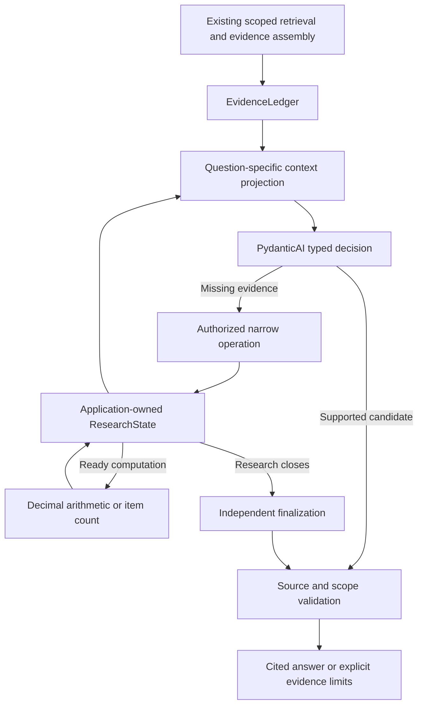
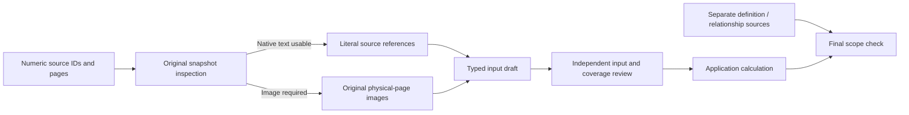

# Agentic research workflow

Updated: 19 October 2026. This document describes the implemented
`pipeline_adaptive_v1` path. The [design rationale](adaptive-rag-research-design.md)
covers architectural choices and future persistence work; the
[answered-question ledger](adaptive-solved-questions.md) records measured results.

## Responsibilities and graph

PydanticAI executes typed agent calls. The application owns the research graph's
state transitions, authorization, tool dispatch, accounting, and release policy.
The current runner uses explicit async Python control flow; a custom
`pydantic-graph.GraphBuilder` runner is not required by this implementation.



`app/wiring.py` connects this workflow to the existing candidate/streaming
interface. It reuses the request-scoped retriever, `DocumentReader`, access
checks, evidence ledger, provider clients, and final renderer. Enabling this
runner selects one orchestration path; it does not first run the fixed answer
pipeline as an additional hidden generation step.

## Application-owned state

`ResearchState` is a Pydantic data structure created and updated by application
code. It is not an LLM-authored summary. It holds the original task, evidence
needs, source selections, checked observations, facts, calculations, coverage,
source inspections, unresolved issues, answer repairs, and execution events.

Each model role receives only the relevant evidence and state projection.
Credentials, internal clients, and the full execution log are not copied into
its prompt. A typed model proposal is validated before the application admits
it as state or executable work. Valid JSON is not proof of source truth.

Three invariants apply throughout:

1. Original evidence and source bindings remain available independently of model prose.
2. Prepared calculations can run without asking a model to select the operation again.
3. Closing research does not erase successful extraction or computation results.

State is serializable and round-trip tested. There is no automatic cross-request
checkpoint service, durable execution, or long-term memory layer. Restoring an
application state in a future persistence service will require source/version
and access revalidation, a continuation point, and preserved usage accounting.
Request-local support IDs must not be reused as globally valid evidence IDs.

## Narrow operation contracts

| Operation | Responsibility | Execution boundary |
| --- | --- | --- |
| `search` | Find missing evidence through existing scoped retrieval or document search. | Cannot accept a tenant override or widen authorized sources. Returned evidence must be admitted by the ledger. |
| `read` | Open selected source chunks or one physical PDF page through `DocumentReader`. | At most 12 IDs; a local read stays within one document/version. Chunk context can span neighboring pages and keeps its actual range. |
| `inspect` | List bounded PDF tables, image regions, captions, and structural elements. | Uses a version-checked PDF snapshot. It is not an exhaustive semantic figure inventory. |
| `extract` | Extract typed observations from source text or an original page image. | Preserves category, series, period, unit, scale, qualifiers, readability, and witness references; does not produce the answer. |
| Quantitative collection | Select and transcribe arithmetic inputs or complete item groups. | Source selection, collection, input review, execution, and final scope have separate contracts. |
| `calculate` | Execute a permitted formula on evidence-bound inputs. | No arbitrary code, invented operands, or network access. Ready plans can be dispatched directly by the application. |

`ResearchDecision` validates the action and required arguments. The dispatcher
projects only that action's arguments: an extra query on a read request does
not turn it into search. Tool visibility and execution-time permission checks
are separate. Document contents are untrusted data, not instructions.

Finalization writes an answer from saved evidence. It cannot reopen research.
The scope reviewer judges claims and their evidence; it cannot retrieve sources,
rewrite the answer, or use a gold answer as a target sentence.

## Context selection and document reads

The evidence builder can expand a small PDF into a large block. Paragraph order
is not retrieval relevance. Initial context preserves reranker anchors through
`anchor_chunk_ids` and chunk provenance; local lexical ranking chooses additional
whole support units without changing embeddings, retrieval, or reranking.

The context has at most 12 full units and 60 short catalog entries. Initial
preparation shows five relevant units and opens admitted source chunks without
another search or parser call. The catalog is not an exhaustive document inventory.

A page view keeps already admitted parser chunks together with headings and
actual page ranges. Duplicate copies of the same source chunk may be removed;
repeated labels or values in different rows are retained. The view is labeled
as parser text, not visual extraction. Source coverage records the opened chunks.
A bounded empty search is not evidence of absence across an entire collection.

## Quantitative source selection and context

`QuantitySelection` separates numeric `support_ids` from
`context_support_ids`. The latter carry definitions or relationships needed to
bind a number to the question, such as which platform a metric description
identifies. The selector explicitly returns an empty context list when no
additional source is needed.

Both lists must reference authorized, model-visible units presented to the
selector. Numeric inputs come from one source/version; context remains
separately traceable. The selector can choose at most three numeric sources,
three context sources, and three numeric input pages.

The application partitions page references by evidence role. If the selector
includes an authorized context page in the common page list, it remains context
rather than becoming a numeric image input. Pages outside both authorized
source ranges are rejected. A broad numeric source still needs a bounded page
window; the application does not guess an arbitrary page.

Context IDs are saved in `QuantityRecord`, included in the deterministic answer
candidate, and restored through owned-proof provenance even if a later candidate
cites only the checked proof. Choosing context is not automatic approval of the
relationship; final scope still checks the original question against the evidence.

## Original-page authority

`PdfStructure.page_quality` inspects the authorized, immutable PDF snapshot in
application code. It records native-text character count and raster image area.
A page requires image reading when it has no native text, or fewer than 40
native characters and raster coverage of at least half its area.

This is a source-routing signal, not a calibrated OCR confidence score. Mixed
pages with substantial native text can still contain misread table cells.
Inspection is bounded by source identity, page count, page area, and timeout.
Receipts are reused for the same source/version and page set within a request.

For quantitative collection, `requires_image` promotes even a model-selected
text source to image reading. The existing collector and checker then receive
the original page images instead of the indexed numeric text. No additional
LLM stage is inserted. Calculation/count candidates cannot bypass this check
by citing the same unverified OCR text through a fast or final answer.
This guard is for declared derived answers, not every number in arbitrary prose.



## Extraction, witnesses, and mode-specific contracts

General extraction records raw and normalized values with their source bindings.
Unreadable or ambiguous observations remain explicit rather than becoming facts.
A parsed draft is saved before independent checking, so a checker timeout does
not delete successful work or turn unchecked data into accepted evidence.

Text quantity collection uses `SourceRange` references: support ID and inclusive
one-based segment bounds. The application resolves exact source text locally.
The text output schema does not ask the model to copy free-form quotations,
shorten them with ellipses, or repair an existing quotation through another call.
Detached headings and values can be bound using separate bounded ranges.

Image quantity schemas require explicit page, witness, and completeness fields.
Page numbers are not inferred from witness prose. Each item must refer to a
supplied physical page. A complete flag is a proposal, not independent approval.

`semantic_draft` exposes only executable fields for the selected mode:

- Arithmetic: named operands, expression, precision, completeness, and witnesses.
  Compatibility fields such as `count_mode=per_group` are omitted.
- Counting: groups, item positions, boundaries, completeness, and the actual
  `per_group`, `total`, or `distinct` operation. Arithmetic fields are omitted.

This projection is used by input checking, repair payloads, checked proof records,
and finalizer context. It prevents an irrelevant default from becoming a new
instruction while retaining the complete typed record for checkpoint compatibility.

## Independent assessment and bounded repair

`QuantityAssessment` judges input accuracy, coverage, and operation separately.
It also records whether entity labels support identity comparison. A correct
number remains correct even when the requested operation is unresolved.

Nonpassing decisions require a `QuantityIssue`: target operand/group/operation,
source location, explanation, and the evidence needed to resolve the issue.
The application checks target indexes, selected page/range bounds, and question
segment references. Bounds checks do not prove a semantic objection is true.
A missing or invalid objection is indeterminate, not approval.

There is at most one corrective allowance in this workflow: either correct an
invalid diagnostic receipt or recollect the specifically defective inputs.
Untargeted operands and groups remain unchanged. Operation repair may require
a different representation, while the original record and provisional result
remain available through `parent_id`.

`QuantityRepairRequirement` carries the missing evidence type. When an arithmetic
count cannot distinguish total memberships from a distinct entity union, the
repair requires individual entity labels. Repeating aggregate counts cannot
complete that contract. An identical source/page/modality view is not treated
as new evidence; another image/page view of a broad source can still be useful.

The application can compare total and distinct counts when the inventory is
complete, identities are supported, and those are the reviewer's explicit
alternatives. Equal scalar results resolve a material ambiguity. Different
results, unresolved aliases, or a per-group vector do not become a scalar answer
by silent normalization. Distinct comparison uses exact case/whitespace-normalized
labels; it does not invent external entity aliases.

## Deterministic execution and finalization

Named arithmetic inputs expand into a restricted expression and run with
Decimal arithmetic. Unknown or unused operands and invalid expressions fail.
Counts execute over checked item inventories. Item location includes page and
position so legitimate repeated entries survive, while duplicate occurrences
are rejected. Total occurrences and unique entities are separate operations.

Successful computation is stored before evidence admission and release. A checked
transcription is labeled as such, linked to original source IDs, and never
presented as original PDF text. Image-derived results require an admitted proof.
The proof contains inputs, calculation results, source authority, and any compared
interpretations. It does not prove itself correct merely by being JSON.

Finalization first tries existing checked results. A research stop does not
force another reader/answerer to guess the same numbers. If only unresolved
quantity records exist, the workflow can return explicit insufficiency. Other
successful computations remain usable. Partial answer repair preserves valid
claims, changes only targeted claims, and reruns normal release checks.

## Source and question-scope verification

Source IDs, authorization, source versions, expression validity, counts, and
critical literals are checked in code. Semantic review checks the actual entity,
period, category, population, condition, and requested operation.

Owned quantitative proofs carry numeric and contextual source IDs into scope
and final release. The original question is authoritative; a model-proposed
need plan does not add new mandatory question requirements. Gold answers are
excluded. Scope objections identify the affected claim, question segment,
source location, and missing evidence. Invalid diagnostics produce an explicit
review error rather than a silent factual rejection or approval.

Question segments are numbered in the model projection. Exact source references
are resolved locally, including bounded slices of long parser lines. The final
renderer validates the released candidate again.

## Budgets and finalization

The runner shares request, token, tool, and elapsed-time limits across stages.
Research also tracks repeated operations, progress, source revisions, and a
finalization reserve. New text is not the only progress signal: a checked
extraction, corrected binding, resolved ambiguity, or completed calculation counts.

The recent document runs used the following profile, independent of provider
credentials and model choice:

```dotenv
AGENTIC_MAX_REQUESTS=10
AGENTIC_MAX_TOKENS=120000
AGENTIC_TIMEOUT_SECONDS=240
AGENTIC_RESEARCH_POLICY={"max_research_requests":6,"max_tool_attempts":6,"max_no_progress":2,"max_validation_repairs":1,"tool_timeout_seconds":60,"model_timeout_seconds":60,"finalize_reserve_seconds":60}
```

The separate `AGENTIC_MAX_TOOL_CALLS` ceiling also applies; the effective tool
allowance is bounded by both that ceiling and the research policy. Individual
semantic stages and page reads have limits within the shared workflow deadline.
A separate aggregate 60-second timeout is not applied to the entire multistage
collection sequence. A reserved phase remains subject to the total deadline,
cancellation, provider availability, and remaining request/token allowance.

Research stop, extraction status, review status, finalization status, and release
status are distinct. A stopped research loop can still produce a verified answer.
A budget/API failure is not proof that the source lacks an answer.

## Observability and local records

Spans expose evidence admission, selection and exclusion, page views, original
source inspection, collection, review, repair, computation, scope, and release.
Useful fields include input/context/proof support IDs, physical pages, native-text
counts, required modality, issue targets, diagnostic errors, and compared results.
They record observable decisions, not a model's private reasoning.

Normal telemetry is bounded metadata. Raw text requires explicit forensic
capture settings. Diagnostic captures preserve full typed state and model outputs
locally. The independent PDF reviewer also receives application receipts so it
can distinguish a saved application calculation from a model proposal.
Projected review text is bounded and marked when truncated; full captures remain.

Adaptive run JSON/JSONL, traces, images, and source capsules are ignored by Git.
Small root Markdown reports and the English answered-question ledger are retained.

## Validation and remaining work

The latest recorded backend suite passed 2,112 tests, with four skips and five
deselected tests; lint and mypy passed. The source-authority changes also passed
66 focused tests. Seven selected questions were answered correctly with the same
code/settings: two calculations and five direct lookups. Fifteen distinct questions
have a historical source-supported success; eight have not been rerun on this code.

The [ledger](adaptive-solved-questions.md) preserves run links, answers, timings,
model calls, label discrepancies, failed intermediate versions, and format limits.
These development checks do not establish a complete benchmark score or stability.
Broader document-held-out evaluation, repeated runs, mixed-layout extraction,
and durable request-spanning persistence remain separate work.
