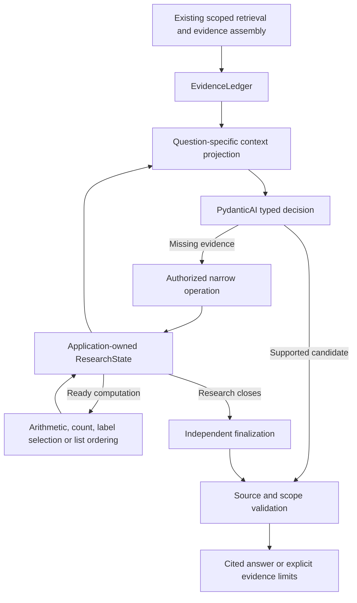
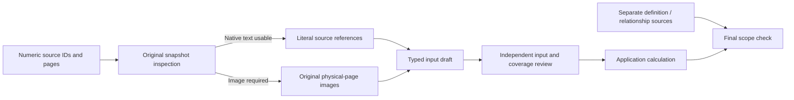

# Agentic research workflow

Updated: 19 October 2026. This document describes the implemented
`pipeline_adaptive_v1` path. The [design rationale](adaptive-rag-research-design.md)
covers architectural choices and future persistence work; the
[answered-question ledger](adaptive-solved-questions.md) records measured results.

## Responsibilities and graph

PydanticAI executes typed agent calls. The application owns the research graph's
state transitions, authorization, tool dispatch, accounting, and release policy.
The current runner uses explicit async Python control flow; a custom
`pydantic-graph.GraphBuilder` runner is not required by this implementation.



`app/wiring.py` connects this workflow to the existing candidate/streaming
interface. It reuses the request-scoped retriever, `DocumentReader`, access
checks, evidence ledger, provider clients, and final renderer. Enabling this
runner selects one orchestration path; it does not first run the fixed answer
pipeline as an additional hidden generation step.

## Application-owned state

`ResearchState` is a Pydantic data structure created and updated by application
code. It is not an LLM-authored summary. It holds the original task, evidence
needs, source selections, checked observations, facts, calculations, coverage,
source inspections, unresolved issues, answer repairs, and execution events.

Each model role receives only the relevant evidence and state projection.
Credentials, internal clients, and the full execution log are not copied into
its prompt. A typed model proposal is validated before the application admits
it as state or executable work. Valid JSON is not proof of source truth.

Three invariants apply throughout:

1. Original evidence and source bindings remain available independently of model prose.
2. Prepared calculations can run without asking a model to select the operation again.
3. Closing research does not erase successful extraction or computation results.

State is serializable and round-trip tested. There is no automatic cross-request
checkpoint service, durable execution, or long-term memory layer. Restoring an
application state in a future persistence service will require source/version
and access revalidation, a continuation point, and preserved usage accounting.
Request-local support IDs must not be reused as globally valid evidence IDs.

## Narrow operation contracts

| Operation | Responsibility | Execution boundary |
| --- | --- | --- |
| `search` | Find missing evidence through existing scoped retrieval or document search. | Cannot accept a tenant override or widen authorized sources. Returned evidence must be admitted by the ledger. |
| `read` | Open selected source chunks or one physical PDF page through `DocumentReader`. | At most 12 IDs; a local read stays within one document/version. Chunk context can span neighboring pages and keeps its actual range. |
| `inspect` | List bounded PDF tables, image regions, captions, and structural elements. | Uses a version-checked PDF snapshot. It is not an exhaustive semantic figure inventory. |
| `extract` | Extract typed observations from source text or an original page image. | Preserves category, series, period, unit, scale, qualifiers, readability, and witness references; does not produce the answer. |
| Quantitative collection | Select and transcribe arithmetic inputs or complete item groups. | Source selection, collection, input review, execution, and final scope have separate contracts. |
| `calculate` | Execute a permitted formula on evidence-bound inputs. | No arbitrary code, invented operands, or network access. Ready plans can be dispatched directly by the application. |

`ResearchDecision` validates the action and required arguments. The dispatcher
projects only that action's arguments: an extra query on a read request does
not turn it into search. Tool visibility and execution-time permission checks
are separate. Document contents are untrusted data, not instructions.

Finalization writes an answer from saved evidence. It cannot reopen research.
The scope reviewer judges claims and their evidence; it cannot retrieve sources,
rewrite the answer, or use a gold answer as a target sentence.

## Context selection and document reads

The evidence builder can expand a small PDF into a large block. Paragraph order
is not retrieval relevance. Initial context preserves reranker anchors through
`anchor_chunk_ids` and chunk provenance; local lexical ranking chooses additional
whole support units without changing embeddings, retrieval, or reranking.

The context has at most 12 full units and 60 short catalog entries. Initial
preparation shows five relevant units and opens admitted source chunks without
another search or parser call. The catalog is not an exhaustive document inventory.

A page view keeps already admitted parser chunks together with headings and
actual page ranges. Duplicate copies of the same source chunk may be removed;
repeated labels or values in different rows are retained. The view is labeled
as parser text, not visual extraction. Source coverage records the opened chunks.
A bounded empty search is not evidence of absence across an entire collection.

## Quantitative source selection and context

`QuantitySelection` separates numeric `support_ids` from
`context_support_ids`. The latter carry definitions or relationships needed to
bind a number to the question, such as which platform a metric description
identifies. The selector explicitly returns an empty context list when no
additional source is needed.

Both lists must reference authorized, model-visible units presented to the
selector. Numeric inputs come from one source/version; context remains
separately traceable. The selector can choose at most three numeric sources,
three context seed sources, and three numeric input pages. The application retains
bounded sibling paragraphs around a context seed when they share the same source
snapshot, tenant, parent block, physical page, and contributing chunk. This keeps
a detached heading with its list without another model call. Expansion adds only
already authorized, visible units, up to six context IDs and within a 6,000-character
expansion allowance; selected seed text is never silently truncated. The
`quantity.context.bind` span records selected seeds and the retained IDs.

The application partitions page references by evidence role. If the selector
includes an authorized context page in the common page list, it remains context
rather than becoming a numeric image input. Pages outside both authorized
source ranges are rejected. A broad numeric source still needs a bounded page
window; the application does not guess an arbitrary page.

Context IDs are saved in `QuantityRecord`, included in the deterministic answer
candidate, and restored through owned-proof provenance even if a later candidate
cites only the checked proof. Choosing context is not automatic approval of the
relationship; final scope still checks the original question against the evidence.

## Original-page authority

`PdfStructure.page_quality` inspects the authorized, immutable PDF snapshot in
application code. It records native-text character count and raster image area.
A page requires image reading when it has no native text, or fewer than 40
native characters and raster coverage of at least half its area.

This is a source-routing signal, not a calibrated OCR confidence score. Mixed
pages with substantial native text can still contain misread table cells.
Inspection is bounded by source identity, page count, page area, and timeout.
Receipts are reused for the same source/version and page set within a request.

For quantitative collection, `requires_image` promotes even a model-selected
text source to image reading. The existing collector and checker then receive
the original page images instead of the indexed numeric text. No additional
LLM stage is inserted. Calculation/count candidates cannot bypass this check
by citing the same unverified OCR text through a fast or final answer.
This guard is for declared derived answers, not every number in arbitrary prose.



## Extraction, witnesses, and mode-specific contracts

General extraction records raw and normalized values with their source bindings.
Unreadable or ambiguous observations remain explicit rather than becoming facts.
A parsed draft is saved before independent checking, so a checker timeout does
not delete successful work or turn unchecked data into accepted evidence.

Text quantity collection uses `SourceRange` references: support ID and inclusive
one-based segment bounds. The application resolves exact source text locally.
The text output schema does not ask the model to copy free-form quotations,
shorten them with ellipses, or repair an existing quotation through another call.
Detached headings and values can be bound using separate bounded ranges.

Native OpenAI semantic stages use PydanticAI `ToolOutput(..., strict=True)`.
The provider enforces JSON shape during generation, including required completeness
fields and disallowed extra fields. Local Pydantic validation still checks cross-field
coherence. Other providers retain their compatibility path and local validation.
This is a data contract, not an answer-template constraint: it does not set source
values, expected labels, or a gold answer, and does not add a schema-repair call.
Each model span records `research.output_strict`; SDK retries remain zero.

Image quantity schemas require explicit page, witness, and completeness fields.
Page numbers are not inferred from witness prose. Each item must refer to a
supplied physical page. A complete flag is a proposal, not independent approval.

`semantic_draft` exposes only executable fields for the selected mode:

- Arithmetic: named operands, expression, precision, completeness, and witnesses.
  Compatibility fields such as `count_mode=per_group` are omitted.
- Counting: groups, item positions, boundaries, completeness, and the actual
  `per_group`, `total`, or `distinct` operation. Arithmetic fields are omitted.
- Selection: source identity labels, decimal measurements, units, and the typed
  `minimum` or `maximum` operation. The application returns every tied label.
  Mixed units require an explicit conversion elsewhere; comparison syntax is
  never enabled in the arithmetic evaluator.
- Conditional lookup: source operands and typed choices join each candidate's
  comparison expression to its requested output operand. Code computes the
  comparison and returns the linked value, retaining ties. Lookup operands keep
  population, series and period explicit; comparison and output can legitimately
  refer to different populations, which are reviewed for their individual roles.
- Listing: flat source items with positions, page witnesses, and owning source
  objects/columns, plus the requested ordering and uniqueness policy. Code
  orders and optionally deduplicates checked items. The independent assessment returns
  the question's uniqueness policy separately from transcription accuracy; two
  correctly read source occurrences are not invalid inputs merely because the
  output asks for a set of names. Lists are not count groups;
  an item page belongs on the item, not an invented group field. A complete empty
  inventory requires a source-bound `absence` record identifying the inspected
  object and condition. An unreadable or partial view is not evidence of absence.

The source checker inspects the requested object's role as well as the visible
condition. A neighboring diagram object with the same color is not sufficient
without a binding to the object requested by the question. Unknown or conflicting
bindings remain review failures; the application does not resolve them with gold
answers or dataset-specific vocabulary.

Execution receipts distinguish pending, completed, and failed execution. A failed
operation retains its input draft, source witnesses, independent assessment, and
execution diagnostic. Successful selections/lists are stored before proof admission
and can be reused by independent finalization without a new answer-writing call.
Unknown JSON fields remain rejected; this does not relax schema validation.

This projection is used by input checking, repair payloads, checked proof records,
and finalizer context. It prevents an irrelevant default from becoming a new
instruction while retaining the complete typed record for checkpoint compatibility.

## Independent assessment and bounded repair

`QuantityAssessment` judges input accuracy, coverage, and operation separately.
It also records whether entity labels support identity comparison. A correct
number remains correct even when the requested operation is unresolved.

Nonpassing decisions require a `QuantityIssue`: target operand/group/item/absence/operation,
source location, explanation, and the evidence needed to resolve the issue.
The application checks target indexes, selected page/range bounds, and question
segment references. Bounds checks do not prove a semantic objection is true.
A missing or invalid objection is indeterminate, not approval.

One invalid diagnostic receipt can be corrected without consuming the independent,
single source-repair allowance. Both use the same hard request/token/time budgets.
Untargeted operands and groups remain unchanged. Operation repair may require
a different representation, while the original record and provisional result
remain available through `parent_id`.

Source-correction collection uses an operand-only schema. The application restores
its existing operation, formula, rounding, lookup choices and read-output conventions;
the model cannot regenerate these fields while correcting a source value. Operand
identities remain fixed, and the targeted merge preserves untargeted observations.
A genuine operation objection follows the separate operation-repair contract.

Evidence is resolved per operand or item. During an image repair, retained text
references remain bound to their authorized literal source ranges and are included
in independent checking. Retained image references are rebound by document identity,
version and physical page, rather than by a previous image handle's ordinal.
Explicitly requested visual context pages are retained with their input pages when
all belong to the same authorized document version, within the existing three-page
ceiling. Input and context roles remain distinct in the receipt.

The source checker can return indexed notation corrections when a readable display
has invalid notation metadata. Code validates each correction without changing the
literal display or reinterpreting a valid number, then checkpoints the new receipt.
A tentative numeric reading and an unknown entity join are distinct from missing
values. Ambiguous readings and unverified lookup joins cannot execute. Relationship
objections may search the same authorized snapshot and carry candidate definition
passages as bounded context; finding a passage does not certify an alias.

Lookup relationship recovery follows the operation and grounded objection rather than
requiring the model to emit a particular optional diagnostic tag. Already admitted,
authorized definition passages for contrasted source labels can be supplied directly
with the prior input window. The application dispatches that bounded collection and
independent review without another LLM source-selection request. Such passages may
establish a distinction; locating them never certifies equivalence. Explicit context
seeds reserve the six-unit/6,000-character context budget before optional search hits
or previous closure paragraphs, so packing cannot silently evict requested page authority.

Numeric read and lookup contracts expose nullable `output_decimals` for precision
explicitly requested by the question. Source values and execution receipts retain
their original precision; only the published display is rounded deterministically.
Source-only repair preserves this output convention with the operation contract.

For an exact application-owned arithmetic or count answer, final scope validation receives a
semantic projection after local reexecution verifies the saved result. Checked inputs,
formula, interpretation, inventory membership and units remain visible; the computed number and generated
result proof are withheld from the model's scope task. It still must positively
verify source bindings and operation compatibility. Ordinary or modified claims do
not use this projection. The release receipt remains bound to the complete original
answer and evidence. A declared conventional operation is an interpretation, distinct
from a claim that the source defines or reports that metric; explicit question or
source definitions remain authoritative.

`QuantityRepairRequirement` carries the missing evidence type. When an arithmetic
count cannot distinguish total memberships from a distinct entity union, the
repair requires individual entity labels. Repeating aggregate counts cannot
complete that contract. If the independent checker identifies the individual roster
on already inspected images, the application reuses that view under a count contract;
this corrects the extraction representation and does not claim new evidence. A real
coverage gap still requires a fuller source view.

For a grounded missing numeric input, application code can search the same
authorized document/version without an LLM. The original question stays in the
query so a mistaken draft population does not become the sole search criterion.
`ResearchState.quantity_gap_searches` stores a typed `QuantityGapSearch`: parent
receipt, evidence requirements, candidate IDs, actually inspected IDs/pages, and
located/inspected/resolved/unresolved status. Located candidates are not facts.

Bounded fresh search candidates are carried into the collector's source window
even if the selector repeats the previous view. Redundant same-page seeds can be
replaced by their complete source region while retaining the three-page ceiling.
A candidate requiring a larger image window is not expanded arbitrarily. The old
receipt remains available; the new extraction and independent source/coverage/
operation checks must still pass before the gap is marked resolved. Moving an
existing source between input and context roles, or changing its ID while keeping
the same content/page view, is not evidence of progress.

`quantity.source.complete`, `quantity.gap.bind`, `quantity.gap.review`, and
`quantity.lookup` spans expose the search-to-inspection handoff, review status,
comparison scores and selected value bindings. These records improve traceability;
they do not make model-based population or visual-condition judgments infallible.

The application can compare total and distinct counts when the inventory is
complete, identities are supported, and those are the reviewer's explicit
alternatives. Equal scalar results resolve a material ambiguity. Different
results, unresolved aliases, or a per-group vector do not become a scalar answer
by silent normalization. Distinct comparison uses exact case/whitespace-normalized
labels; it does not invent external entity aliases.

### Inventory validation without parser-specific answer constraints

Original question requirements govern scope. Models may identify and interpret the
appropriate source object; parser line IDs, font styles and inferred heading boundaries
are optional observation aids. Missing structural metadata is not a factual mismatch.
An independent source review still verifies item membership and completeness. Native
checks flag concrete observed counterexamples, such as a textual item after the stated
sibling boundary, an omitted explicit identifier in the inspected inventory, or selecting
the top caption when the question explicitly asks for the bottom figure. Bold numeric
row labels are not sibling categories. A footer or native heading handle alone does not
certify inventory completeness.

A count input review can propose exactly one alternative operation when only scalar,
vector or distinct presentation is wrong. With independently supported, complete input
groups and no source objections, the application patches the operation, preserves the
original review and computes locally. It never changes the item observations. A distinct
operation additionally requires supported entity identity. Ambiguous alternatives and
incomplete coverage remain unresolved; they are not repaired by silently summing.

The final scope reviewer receives the checked inventory and its original source IDs.
It judges whether that inventory answers the requested category, location and scope;
it does not demand that every checked image label also survive parser extraction. This
extends the existing arithmetic responsibility split to counting. Local reexecution and
exact candidate matching protect the projection; changed or unchecked claims retain full
validation. No extra model stage or budget increase is introduced.

`quantity.inventory.observe`, `quantity.inventory.validate` and
`quantity.operation.correct` spans expose native observations, concrete counterexamples
and application-owned operation changes. A source catalog may include literal lines
matching question terms from the middle of a page, within its existing six-line and
page limits. These remain location hints, not a complete inventory or an approval receipt. The
catalog also exposes bounded literal numbered labels, sharing its existing character
budget with line hints. This lets source selection see detailed entries that an
incomplete summary omits. If an inspected original page contains numbered labels absent
from the selected indexed text, the application supplies those same authorized pages as
images to the existing collector/checker; it adds no model stage and stays within the
three-page ceiling. Contiguous one- or two-page count selections can use the remaining
window capacity for continuation/boundary pages; disjoint selections are not filled
arbitrarily.

Optional object/closure descriptions have the same bounded text capacity as other source
locators. A descriptive locator cannot discard an otherwise valid typed extraction solely
because it exceeds a short native-ID limit. Checked empty categories retain their zero
contribution in the application computation and source receipt; the candidate omits empty
legacy occurrence-count claims, whose validator correctly rejects unsupported empty lists.
An unchecked empty extraction still cannot become a zero answer.

Numeric collection declares `value_origin`: a source-printed display or an item count.
If an arithmetic reader locates counted items, the application preserves its observation
and hands the same known source view to the count contract. It does not treat an internal
headcount as a printed number or ask another selector to rediscover the roster. The
handoff obeys the shared tool/repair/model budgets, and execution still requires the
independently reviewed individual inventory.

Text source ranges remain authoritative even when their complete contents exceed the
optional quote field. The application retains the exact ranges and original source;
it leaves the optional copied witness empty rather than truncating it or rejecting the
extraction. Retained text inputs in an image repair are resolved from those ranges for
numeric verification. Invalid or unauthorized ranges still fail.

After accepted count execution, bounded native PDF observations are admitted as original
source units with their immutable document version and actual physical page. They are
separate from generated checked-transcription/result proofs and are cited alongside them.
Final scope can therefore inspect actual Unit/category/caption text omitted by the index,
without demanding another extraction. Native model views keep every line ID and literal
text, while attaching coordinates/font metadata only to structural hints. The full native
observation remains in application state; this is deterministic serialization, not an
LLM-written summary. A boundary objection requests a fuller source window; a visible
boundary witness is not a reason to recollect the same insufficient pages. `quantity.source.native` records their source IDs;
`quantity.source.handoff` records a numeric-to-inventory handoff. Neither uses a model
summary as original source evidence or changes the index.

## Deterministic execution and finalization

Named arithmetic inputs expand into a restricted expression and run with
Decimal arithmetic. Unknown or unused operands and invalid expressions fail.
Counts execute over checked item inventories. Item location includes page and
position so legitimate repeated entries survive, while duplicate occurrences
are rejected. Total occurrences and unique entities are separate operations.

Successful computation is stored before evidence admission and release. A checked
transcription is labeled as such, linked to original source IDs, and never
presented as original PDF text. Image-derived results require an admitted proof.
The proof contains inputs, calculation results, source authority, and any compared
interpretations. It does not prove itself correct merely by being JSON.

Finalization first tries existing checked results. A research stop does not
force another reader/answerer to guess the same numbers. If only unresolved
quantity records exist, the workflow can return explicit insufficiency. Other
successful computations remain usable. Partial answer repair preserves valid
claims, changes only targeted claims, and reruns normal release checks.

## Source and question-scope verification

Source IDs, authorization, source versions, expression validity, counts, and
critical literals are checked in code. Semantic review checks the actual entity,
period, category, population, condition, and requested operation.

Owned quantitative proofs carry numeric and contextual source IDs into scope
and final release. The original question is authoritative; a model-proposed
need plan does not add new mandatory question requirements. Gold answers are
excluded. Scope objections identify the affected claim, question segment,
source location, and missing evidence. Invalid diagnostics produce an explicit
review error rather than a silent factual rejection or approval.

Question segments are numbered in the model projection. Exact source references
are resolved locally, including bounded slices of long parser lines. The final
renderer validates the released candidate again.

## Budgets and finalization

The runner shares request, token, tool, and elapsed-time limits across stages.
Research also tracks repeated operations, progress, source revisions, and a
finalization reserve. New text is not the only progress signal: a checked
extraction, corrected binding, resolved ambiguity, or completed calculation counts.

The recent document runs used the following profile, independent of provider
credentials and model choice:

```dotenv
AGENTIC_MAX_REQUESTS=10
AGENTIC_MAX_TOKENS=120000
AGENTIC_TIMEOUT_SECONDS=240
AGENTIC_RESEARCH_POLICY={"max_research_requests":6,"max_tool_attempts":6,"max_no_progress":2,"max_validation_repairs":1,"tool_timeout_seconds":60,"model_timeout_seconds":60,"finalize_reserve_seconds":60}
```

The separate `AGENTIC_MAX_TOOL_CALLS` ceiling also applies; the effective tool
allowance is bounded by both that ceiling and the research policy. Individual
semantic stages and page reads have limits within the shared workflow deadline.
A separate aggregate 60-second timeout is not applied to the entire multistage
collection sequence. A reserved phase remains subject to the total deadline,
cancellation, provider availability, and remaining request/token allowance.

Research stop, extraction status, review status, finalization status, and release
status are distinct. A stopped research loop can still produce a verified answer.
A budget/API failure is not proof that the source lacks an answer.

## Observability and local records

Spans expose evidence admission, selection and exclusion, page views, original
source inspection, collection, review, repair, computation, scope, and release.
Useful fields include input/context/proof support IDs, physical pages, native-text
counts, required modality, issue targets, diagnostic errors, and compared results.
They record observable decisions, not a model's private reasoning.

Normal telemetry is bounded metadata. Raw text requires explicit forensic
capture settings. Diagnostic captures preserve full typed state and model outputs
locally. The independent PDF reviewer also receives application receipts so it
can distinguish a saved application calculation from a model proposal.
Projected review text is bounded and marked when truncated; full captures remain.

Adaptive run JSON/JSONL, traces, images, and source capsules are ignored by Git.
Small root Markdown reports and the English answered-question ledger are retained.

## Validation and remaining work

The latest recorded backend suite passed 2,125 tests, with four skips and five
deselected tests; lint and mypy passed. The source-authority changes also passed
66 focused tests. Seven selected questions were answered correctly with the same
code/settings: two calculations and five direct lookups. Fifteen distinct questions
have a historical source-supported success; eight have not been rerun on this code.

The [ledger](adaptive-solved-questions.md) preserves run links, answers, timings,
model calls, label discrepancies, failed intermediate versions, and format limits.
These development checks do not establish a complete benchmark score or stability.
Broader document-held-out evaluation, repeated runs, mixed-layout extraction,
and durable request-spanning persistence remain separate work.


### Bounded document-inventory location policy

Source selection declares `inventory_scope` as document-wide, a bounded object/subset,
or unknown. For a declared document-wide count with one matching numbered-label family,
application code can prefer a same-document/version window that strictly covers more
of the already observed identifiers. The window remains within three physical pages
and three authorized, model-visible source seeds. It changes the acquisition location,
not the question, item membership, computed answer or completeness verdict. Bounded and
unknown scopes keep their selected windows. Multiple matching families are left to
semantic source selection rather than collapsed into one list.

The candidate windows are generated from literal native label observations with a bounded
coverage heuristic. No expected answer, fixed document name or reference page is supplied.
`quantity.source.window` records old/new pages and source IDs. Independent source review
still inspects the original pages against the actual question. This policy does not solve
arbitrary inventories requiring more than one three-page window; reusable partial-coverage
accumulation remains a separate extension.


## Typed collection dispatch and scope repair

A failed fast answer is not itself a numeric task. Count and calculation needs dispatch
the corresponding bounded collection capability. Otherwise the existing fast-answer
call can declare text, numeric lookup or source-list requirements; unknown tasks
continue ordinary research. A compatible numeric/list hint can refine a lookup, sort
or comparison plan, while a generic calculation hint cannot replace a planned lookup.
The selected evidence-need ID and its constraints are carried into source collection.
This adds no separate router model request.

The application stores each collection outcome as a typed receipt in `ResearchState`:
status, need ID, record IDs and source support IDs. Missing sources, unresolved reviews
and errors return to the bounded reader rather than closing research merely because
a draft exists. Unchecked quantities stay checkpointed and are not presented as verified
results. Repeating the rejected result against unchanged source evidence cannot certify
it. Independently checked facts, calculations and newly acquired source evidence remain
available to finalization, including after the research tool budget ends.

Grounded scope objections declare a repair kind. Missing observations or contradictory
scope require a fresh source view. Existing-source relationships, interpretation, unit
transformation and presentation may reuse the original authorized source and skip the
selector. These are repair proposals, not acceptance receipts: the replacement still
passes independent input/coverage/operation review, deterministic execution and final
scope validation. A mixed, unknown or invalid diagnostic retains the fresh-source path.
This dispatch change does not implement missing unit-conversion capabilities.

`research.collection.route`, `research.collection.resume` and `quantity.repair.route`
spans expose the chosen capability, checkpoint IDs and freshness requirement without
copying source content into span attributes. Existing request, tool, time and repair
budgets apply to continuation as well as initial collection.


## Opening located source evidence

A source locator is not an extraction receipt. Explicit quantitative text pages can be
opened through the existing bounded document reader before collection. Application-owned
page-acquisition records bind source, immutable version, requested page, admitted view
IDs and scan flags. Full visible reads can be reused; partial reads retain their limits.
Opening charges the shared tool budget and does not change retrieval or embeddings.

A question-grounded `acquisition=image` need can dispatch a narrow visual page locator,
then the existing original-image object matcher, extractor and independent checker.
The locator only chooses where to inspect; the matcher establishes scope and the
extractor records observations. Nonnumeric relationships stay text, without fabricated
measurements. Generic text observations allow 1,000 characters; deterministic numeric
execution retains its separate bounds. Successful observations remain available to
finalization even when later research cannot continue.

`research.acquire.visual` and `quantity.source.open` spans show physical pages, evidence
lineage and partial-read flags. Same-version authorization, source constraints, operation
checks, final scope validation and all existing budgets remain in force.
