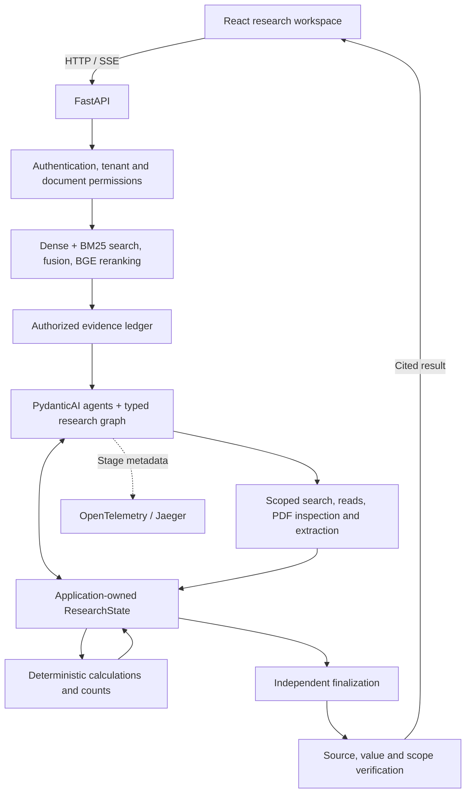
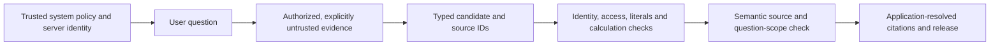

# Knowledge Base Research Workspace architecture

The product combines a document research workspace with an application-controlled
agentic backend. PydanticAI handles typed semantic calls; the application owns
research state, authorization, tools, computation, budgets, and answer release.
See the [detailed research graph and contracts](adaptive-workflow.md) and
[answered-question ledger](adaptive-solved-questions.md).

## Service responsibilities

React owns presentation state and client-observed stream timing. FastAPI owns
identity, role and document checks, retrieval scope, research orchestration,
SSE production, and read-only `/ui/*` aggregation. Qdrant stores indexed knowledge;
the selected provider supplies model calls; Jaeger exposes trace spans.

The workspace presents citations, source inspection, stage progress, research
notes, projects, feedback, and trace details. Backend orchestration changes do
not require replacing its existing presentation model or screenshots.

`/ui/*` endpoints aggregate existing domain logic. They do not accept a
caller-selected tenant, expose internal clients/credentials, or create a privileged
request path. Application settings are injected at boot, so index reporting,
tracing, and runtime wiring read the same `Settings` instance.

## Research graph

The adaptive runner evaluates evidence, answers directly when possible, and
opens focused research for a concrete gap. Tools return evidence or structured
inputs, never permission to bypass release checks. The application can execute
a prepared calculation without another model planning turn.

`ResearchState` stores evidence needs, checked observations, source versions,
calculations, unresolved issues, and diagnostics. Each model receives a focused
projection. Research closure preserves successful work for independent finalization.
Serializable state does not imply automatic cross-request checkpoint recovery.

The implemented graph uses explicit async application control flow around
PydanticAI calls. GraphBuilder and durable workflow persistence are separate
composition decisions discussed in the [design rationale](adaptive-rag-research-design.md).

## Evidence and computation

Initial retrieval combines dense and BM25 search, rank fusion, and multilingual
BGE reranking. Section-aware assembly preserves nearby headers and captions.
Research tools reuse this authorized index and document reader; the adaptive
layer does not replace embeddings or re-ingest documents to answer a question.

Quantitative source inspection checks whether a bounded PDF page has usable
native text. Image-heavy pages can be read from the immutable original snapshot.
Extracted values retain labels, series, period, unit, scale, and witnesses.
Numeric evidence and definition/entity-relationship evidence are carried
separately and meet again at final scope verification.

Arithmetic uses permitted expressions and evidence-bound operands. Counts use
checked inventories and source positions. Application results are saved before
release, and checked transcriptions are explicitly distinguished from original
PDF text. Source routing and two-model agreement do not guarantee OCR accuracy.

## Trust and release boundaries

Document body and metadata remain data rather than provider system instructions.
`app/llm/trust_boundary.py` defines the fixed-path serialization boundary; agent
roles use explicit task/data contracts. Unknown, hidden, cross-tenant, or stale
source references cannot be authorized by a model decision.

Support IDs are request-scoped. The application resolves them to exact source
text; a valid ID proves provenance, not semantic entailment. Claim-local critical
value checks evaluate literals and their bindings. Independent semantic review
checks the requested entity, period, population, condition, and operation.
Gold answers are excluded from runtime generation and scope verification.

Both supported answers and explicit evidence limits are legitimate release
outcomes. API failure, exhausted budget, absent evidence, and reviewer uncertainty
are recorded separately. Finalization remains subject to hard shared ceilings.

Normal telemetry is bounded metadata. Raw questions, answers, model outputs, and
evidence require explicit forensic capture settings and remain local in the
adaptive diagnostic workflow. Git retains small Markdown reports rather than
raw traces, images, and source capsules.

## Runtime profiles

`ADAPTIVE_RAG_ENABLED=true` selects the typed research graph.
`AGENTIC_RAG_ENABLED=true` selects the alternative single-agent tool runner;
the two flags are mutually exclusive. Their tools reuse existing retrieval,
PDF inspection, source contracts, and final validators. With neither selected,
the fixed answer path remains available. See [configuration](../.env.example).

The fixed path supports `fast` streaming and `strict` buffered release behavior.
Its short policy is in `prompts/answer_v3.txt`. Phase 6 answerability classifiers
and shadow evaluators are separate evaluation components, not mandatory semantic
calls in that fixed path. These components should not be confused with the
adaptive graph's own input and scope checks.

## Further reading

- [Agentic graph, state, tools, and budgets](adaptive-workflow.md)
- [Architectural rationale and persistence choices](adaptive-rag-research-design.md)
- [PydanticAI orchestration research](pydantic-workflow-research.md)
- [Source-grounded validation](rag-validation-research.md)
- [Security model](security.md)
- [Alternative agent runner](agentic-rag.md)
